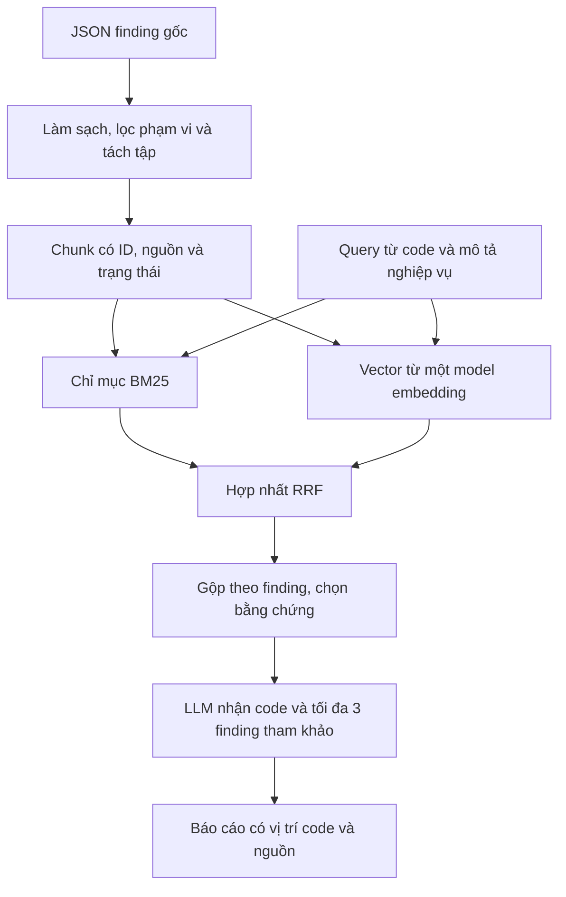

# Lựa chọn embedding cho dự án hỗ trợ audit smart contract

> Đề xuất ngày 23/10/2026, dựa trên [phạm vi dự án](README.md) và [phân tích dữ liệu](phan_tich_du_lieu.md). Thông số model được đối chiếu với tài liệu chính thức. Chưa chạy embedding hoặc benchmark các model trên corpus của dự án.

**Phương án tôi đề xuất là BM25 kết hợp một model embedding đa ngôn ngữ. Ưu tiên thử `BAAI/bge-m3` cho hướng chạy local; dùng `intfloat/multilingual-e5-small` nếu cần nhẹ hơn; chọn `text-embedding-3-small` nếu ưu tiên API và giảm công vận hành.** `Qwen/Qwen3-Embedding-0.6B` là ứng viên mở rộng khi cần khảo sát thêm truy xuất kết hợp văn bản và code. Chỉ chốt model sau pilot, không triển khai đồng thời tất cả.

## 1. Embedding giải quyết phần nào của dự án?

Embedding biến một đoạn văn bản thành vector để tìm những đoạn có nội dung gần với truy vấn. Trong dự án này, nó phục vụ **truy xuất finding tham khảo từ Solodit**; LLM nhận các đoạn được chọn cùng code để phân tích và lập báo cáo.

Ví dụ, truy vấn tiếng Việt “rút tài sản nhưng số cổ phần bị trừ quá ít” có thể cần tìm báo cáo tiếng Anh dùng các từ `withdraw`, `shares`, `rounding` và `mulDiv`. Embedding đa ngôn ngữ là một cách xử lý khác biệt cách diễn đạt và ngôn ngữ. Khả năng tìm đúng cơ chế lỗi phải được đo, không suy ra chỉ từ nhãn “multilingual”.

Phép thử BM25 hiện có trong [kết quả cục bộ](analysis/retrieval_smoke_test.json) ghi nhận 5/6 ID đích vào top 5 với truy vấn Anh, còn sáu truy vấn Việt thuần đều không có kết quả điểm dương. Các truy vấn được viết sau khi đọc finding: đây là dấu hiệu cần cải thiện truy xuất, **không phải Recall@5 của toàn corpus hoặc độ chính xác audit**.

Embedding không xác nhận một contract có lỗ hổng. Finding tham khảo chỉ cung cấp mẫu cơ chế; kết luận vẫn cần bằng chứng trên code đích. Model embedding cũng độc lập với model LLM sinh báo cáo, nên có thể dùng embedding local cùng LLM qua API.

## 2. Những model nên đưa vào danh sách lựa chọn

| Phương án | Triển khai | Vector | Giới hạn đầu vào theo tài liệu | Khi nên chọn |
|---|---|---:|---:|---|
| [`BAAI/bge-m3`](https://huggingface.co/BAAI/bge-m3) | Local | 1.024 chiều cho dense | 8.192 token | Ứng viên chính khi muốn xử lý đa ngôn ngữ và có thể vận hành model local |
| [`intfloat/multilingual-e5-small`](https://huggingface.co/intfloat/multilingual-e5-small/raw/main/README.md) | Local | 384 chiều | 512 token | Phương án nhẹ hơn để thử trên máy hạn chế tài nguyên |
| [`text-embedding-3-small`](https://developers.openai.com/api/docs/guides/embeddings) | OpenAI API | Mặc định 1.536 chiều | 8.192 token | Muốn tích hợp nhanh, không tải và phục vụ model embedding local |
| [`Qwen/Qwen3-Embedding-0.6B`](https://huggingface.co/Qwen/Qwen3-Embedding-0.6B) | Local | Tối đa 1.024 chiều | 32K token | Thử nghiệm mở rộng cho truy xuất văn bản và code nếu còn thời gian |

Giới hạn đầu vào là mức model hỗ trợ, không phải kích thước chunk nên dùng. Tokenizer giữa các model khác nhau; số chiều lớn hơn cũng không tự bảo đảm truy xuất tốt hơn.

### BGE-M3: ứng viên chính cho hướng local

BGE-M3 hỗ trợ đa ngôn ngữ và ba dạng truy xuất: dense, sparse và multi-vector. Theo model card, model này không cần thêm instruction vào query như một số model BGE khác. [Nguồn: model card BGE-M3](https://huggingface.co/BAAI/bge-m3).

**Cách tôi đề xuất dùng trong dự án:** trước tiên chỉ lấy dense embedding và kết hợp với BM25 sẵn có. Cách này cho phép đo riêng giá trị của embedding, đồng thời giữ được nhánh tìm tên hàm và thuật ngữ chính xác. Chưa cần bật sparse và multi-vector cùng lúc.

Lý do đưa BGE-M3 lên đầu danh sách là yêu cầu truy vấn Việt/Anh và nội dung báo cáo có cả mô tả lẫn code. Đây là lựa chọn để thử nghiệm, chưa có bằng chứng nó tốt nhất cho Solidity. Model có thể chạy CPU, nhưng phải đo thời gian tạo chỉ mục, độ trễ query và RAM trên máy thực tế trước khi chốt.

### Multilingual-E5-small: phương án khi tài nguyên hạn chế

E5-small đa ngôn ngữ cho vector 384 chiều và cắt đầu vào quá 512 token. Khi truy xuất, query phải có tiền tố `query: ` và tài liệu phải có `passage: `, kể cả với tiếng Việt. [Nguồn: model card Multilingual-E5-small](https://huggingface.co/intfloat/multilingual-e5-small/raw/main/README.md).

Đây là ứng viên khi cần giảm tải so với BGE-M3. Điểm phải xử lý là finding dài: cần chia đoạn trước khi encode để không mất phần điều kiện hoặc nguyên nhân ở cuối. Việc nhẹ hơn không bảo đảm đáp ứng độ trễ mong muốn trên mọi CPU; vẫn cần pilot.

Ví dụ định dạng đầu vào:

```text
query: rút tài sản nhưng số cổ phần bị trừ quá ít
passage: Title: ...
Section: Vulnerability details
Content: ...
```

### Text-embedding-3-small: phương án ưu tiên triển khai qua API

Model này có vector mặc định 1.536 chiều, hỗ trợ giảm số chiều qua tham số `dimensions`. Giá được công bố khi kiểm tra là **0,02 USD/triệu token đầu vào**. [Nguồn: OpenAI Docs về embedding](https://developers.openai.com/api/docs/guides/embeddings), [trang model và giá](https://developers.openai.com/api/docs/models/text-embedding-3-small).

Tôi sẽ chọn phương án này nếu thời gian vận hành local ảnh hưởng tiến độ đồ án và việc gửi nội dung cần embed qua API phù hợp với phạm vi dự án. Bắt đầu với số chiều mặc định để giảm biến số thí nghiệm; chỉ giảm chiều khi có nhu cầu lưu trữ hoặc độ trễ đã đo được.

Chi phí phải tính cả đoạn title lặp lại, overlap, query và các lần dựng lại chỉ mục:

```text
Chi phí embedding = tổng token gửi thực tế / 1.000.000 × đơn giá
```

Ví dụ giả định 3.000 chunk, trung bình 500 token/chunk, tương đương 1,5 triệu token và khoảng 0,03 USD cho một lần embed corpus ở đơn giá trên. **Đây không phải số token đã đo của dữ liệu hiện có**, chưa gồm query, retry, lưu trữ hay LLM sinh báo cáo. Số finding và số chunk cũng có thể khác nhau; kiểm tra lại giá trước khi chạy batch.

### Qwen3-Embedding-0.6B: ứng viên mở rộng

Model card công bố hỗ trợ đa ngôn ngữ, code retrieval và instruction cho tác vụ; query có thể dùng định dạng `Instruct: ...` rồi `Query: ...`, còn tài liệu không cần instruction tương ứng. [Nguồn: model card Qwen3-Embedding-0.6B](https://huggingface.co/Qwen/Qwen3-Embedding-0.6B).

Tôi chỉ đưa model này vào vòng thử tiếp theo nếu muốn khảo sát truy xuất từ mô tả kèm đoạn Solidity và còn đủ thời gian đo tài nguyên. Hỗ trợ code retrieval nói chung chưa chứng minh model đã được đánh giá tốt cho lỗi logic Solidity. Context 32K cũng không phải lý do để embed cả repository thành một vector.

## 3. Chọn cách truy xuất trước khi mở rộng số model

| Cấu hình | Vai trò trong dự án | Quyết định đề xuất |
|---|---|---|
| BM25 | Tìm từ khóa, identifier và thuật ngữ xuất hiện trực tiếp | Giữ làm baseline; đây không phải model embedding neural |
| Dense embedding | Tìm nội dung gần nghĩa và khảo sát truy xuất Việt–Anh | Thử bằng một model trong danh sách trên |
| BM25 + dense embedding | Kết hợp khớp từ với gần nghĩa | Cấu hình mục tiêu nếu pilot cho thấy có lợi |
| Learned sparse, ví dụ đầu ra sparse của BGE-M3 | Truy xuất bằng trọng số token do model học | Mở rộng sau; không đồng nhất với BM25 |
| Multi-vector, ví dụ nhánh ColBERT của BGE-M3 | Biểu diễn đoạn bằng nhiều vector để đối sánh chi tiết hơn | Hoãn trong MVP vì tăng công lưu trữ, tìm kiếm và đánh giá |

Với hybrid, tôi đề xuất lấy top 20 chunk từ BM25 và top 20 từ dense, rồi hợp nhất bằng **Reciprocal Rank Fusion (RRF)**. Đây là tham số khởi đầu cần chỉnh trên development. RRF dùng thứ hạng nên không cần cộng trực tiếp điểm BM25 và cosine vốn có thang đo khác nhau. [Công thức và ví dụ trong tài liệu Elastic](https://www.elastic.co/docs/reference/elasticsearch/rest-apis/reciprocal-rank-fusion).

```text
RRF(d) = tổng 1 / (c + rank_i(d)) trên các danh sách có d
```

Có thể bắt đầu với `c = 60`, hạng bắt đầu từ 1. Sau hợp nhất, gộp các chunk theo finding, giới hạn số đoạn từ cùng một báo cáo và đưa tối đa 3 finding tham khảo vào LLM theo phạm vi README. Giữ ID chunk để dẫn đúng đoạn gốc.

Nếu top đầu vẫn thường chứa tài liệu cùng chủ đề nhưng sai cơ chế, có thể thử [`BAAI/bge-reranker-v2-m3`](https://huggingface.co/BAAI/bge-reranker-v2-m3). Reranker chấm lại cặp query–đoạn văn; nó là bước bổ sung, không tạo vector thay cho embedding. Đánh giá phần này riêng vì làm tăng độ trễ.

## 4. Chuẩn bị dữ liệu để embedding có ích

**Nguồn dựng chỉ mục nên là JSON gốc trong [rag_output_last_3000](rag_output_last_3000/)**, sau chuẩn hóa. Bản Markdown phục vụ đọc và dẫn chứng; phân tích hiện có đã ghi nhận một số vấn đề serialize frontmatter. Giữ nguyên raw và hash để truy vết.

| Thành phần | Cách sử dụng đề xuất |
|---|---|
| `title` và nội dung phần đang truy xuất | Đưa vào văn bản embedding |
| Mô tả cơ chế, điều kiện, tác động và đoạn code liên quan | Giữ mạch giải thích khi chia chunk |
| PoC, mitigation, patch và lịch sử xử lý | Tách thành các phần có nhãn; không trộn bản lỗi và bản sửa mà mất trạng thái |
| ID, protocol, firm, severity nguồn, URL, parent ID, trạng thái | Lưu metadata để lọc, gộp và dẫn nguồn |
| Logo, bookmark, trạng thái đã đọc, điểm mặc định | Bỏ khỏi văn bản embedding |
| `summary` | Có thể bổ trợ, không thay body: 1.862/3.000 bản ghi hiện không có summary |

Các quyết định này dựa trên [phân tích cấu trúc dữ liệu hiện có](phan_tich_du_lieu.md). Không dùng `categories` làm bộ lọc nhóm lỗi bắt buộc khi 2.994/3.000 file Markdown đang có `categories: []`; cần xác minh hoặc bổ sung nhãn trước.

Quy tắc chunk khởi đầu:

- Finding ngắn và vừa giới hạn token: giữ nguyên mạch nội dung trong một chunk.
- Finding dài: chia theo phần mô tả, cơ chế, PoC và khuyến nghị; mỗi chunk có `parent_id`, `section`, title và nguồn.
- Với E5-small: thử khoảng 300–400 token nội dung, overlap 40–60 khi cần; tổng cả tiền tố, title và special token phải nằm trong 512.
- Với BGE-M3 hoặc API: thử khoảng 400–800 token nội dung, overlap 50–100 khi cần. Đây là điểm bắt đầu, không phải cấu hình đã tối ưu.
- Giữ code cùng phần giải thích liên quan. Nếu một code block quá dài, tách theo hàm hoặc khối logic và lưu quan hệ với phần liền kề, tránh cắt máy móc giữa biểu thức.

Mỗi model dùng tokenizer riêng. Khi so chất lượng model, giữ cùng nội dung chunk nếu vừa mọi giới hạn; nếu thay cả model lẫn cách chunk, phải ghi rõ đó là so sánh cấu hình tổng thể.

## 5. Luồng triển khai đề xuất



Đối với chức năng tra cứu, query là câu hỏi người dùng. Đối với audit, query phải được tạo theo quy tắc cố định từ code và mô tả nghiệp vụ được phép dùng: tên hàm, biến, phép tính và thứ tự cập nhật. Không dùng finding tham chiếu hoặc tên lỗi chuẩn của ca test để sinh query. Nếu dùng thêm một lượt LLM để mô tả code thành query, ghi riêng chi phí và ảnh hưởng của lượt đó.

Với vài trăm finding ở pilot, có thể lưu vector thành ma trận và tính cosine trực tiếp; chưa cần dịch vụ vector database. Khi mở rộng, đo trước rồi mới chọn FAISS, Qdrant hoặc hệ lưu trữ khác. Vector database là nơi lưu và tìm vector, không phải model tạo embedding.

Những điểm cần khóa để tái lập:

- Query và corpus phải dùng cùng model, revision, số chiều và quy tắc xử lý tương ứng. Đổi model thì dựng chỉ mục riêng; hai model cùng 1.024 chiều vẫn không dùng chung không gian vector.
- Chuẩn hóa vector L2 nếu dùng tích vô hướng để tính cosine. Điểm similarity không phải xác suất có lỗ hổng.
- Lưu model ID/revision, tokenizer, prefix/instruction, cấu hình chunk, hash nội dung và phiên bản pipeline; dùng chúng làm khóa cache.
- Chỉ embed lại chunk thay đổi. Đo thời gian tạo chỉ mục riêng với độ trễ query, ghi cả lần tải model đầu tiên nếu có.
- Với thí nghiệm audit, loại project test, fork, báo cáo cùng sự cố và bản sao liên quan khỏi kho trước khi dựng chỉ mục. Không chỉ lọc theo ID finding.

## 6. Cách chọn model bằng thực nghiệm

Bắt đầu với **50–100 finding đã đọc kiểm tra**, rồi mở rộng khoảng 100–300 finding đúng phạm vi vault/staking nếu pilot ổn. Không cần embed toàn bộ 3.000 finding ngay khi dữ liệu còn lẫn miền và thiếu nhãn nhóm lỗi.

Tạo khoảng 40–60 truy vấn pilot: có diễn đạt theo tình huống, identifier, Việt/Anh và câu không có bằng chứng trong kho. Chia development/test trước khi chỉnh. Các câu song ngữ cùng ý định nên ở cùng tập; mỗi query có thể có nhiều tài liệu liên quan với mức 0: không liên quan, 1: một phần, 2: trực tiếp hữu ích.

| Cấu hình | Mục đích |
|---|---|
| R0: BM25 | Mốc so sánh trên cùng corpus đã làm sạch |
| R1: Dense với model được thử | Đo khả năng truy xuất của embedding |
| R2: BM25 + cùng model dense + RRF | Đo giá trị của kết hợp hai nhánh |
| R3: R2 + reranker, nếu còn thời gian | Đo giá trị và chi phí của bước xếp hạng lại |

Với query tiếng Việt, có thể thêm đối chứng BM25 dùng bản query tiếng Anh được tạo theo quy trình cố định, giữ nguyên identifier. Báo kết quả và công dịch riêng; BM25 vốn không tự chuyển ngôn ngữ. Nếu runtime query của chức năng audit luôn là tiếng Anh, phải đánh giá trên phân bố đó, không chỉ căn cứ vào câu hỏi Việt ở giao diện.

Đo Recall@5/10 trên các tài liệu liên quan đã gán nhãn, nDCG@10 cho relevance nhiều mức, thời gian query p50/p95, RAM/VRAM và chi phí. Gộp về finding khi báo chỉ số để nhiều chunk từ một finding không được tính như nhiều kết quả độc lập. Công bố giới hạn nhãn chưa đầy đủ và đánh giá riêng các câu không có bằng chứng; chỉ hiệu chỉnh ngưỡng từ chối trên development, không dùng một ngưỡng cosine chung cho mọi model.

Sau khi chọn retriever, mới kiểm tra **nó có giúp audit tốt hơn không**: so A1 không truy xuất và A2 có truy xuất như [thiết kế trong README](README.md), giữ model LLM và cách chấm nhất quán. Chất lượng retrieval tăng chưa đủ để kết luận precision/recall phát hiện lỗi tăng.

## 7. Quyết định phù hợp với nguồn lực hiện tại

| Điều kiện thực tế | Lựa chọn tôi đề xuất |
|---|---|
| BGE-M3 chạy được với thời gian và RAM chấp nhận được | BM25 + dense BGE-M3 là cấu hình mục tiêu để đánh giá |
| Muốn chạy local nhưng BGE-M3 không đáp ứng tài nguyên | Thử BM25 + Multilingual-E5-small với chunk ngắn hơn |
| Cần hoàn thành nhanh, có ngân sách API và có thể gửi nội dung cần embed | BM25 + text-embedding-3-small |
| Đã có baseline ổn và muốn nghiên cứu thêm truy xuất văn bản/code | Thử Qwen3-Embedding-0.6B trong một thí nghiệm mở rộng |
| Hybrid không cải thiện trên bộ kiểm tra hoặc tốn nguồn lực quá mức | Giữ BM25 và báo cáo kết quả âm của embedding |

Với đồ án một người trong 10 tuần, tôi sẽ **làm BM25 trước, chọn một nhánh embedding local hoặc API để pilot, rồi so dense với hybrid**. Chỉ thêm một ứng viên đối chứng khi cần giải quyết vấn đề đã quan sát được. Fine-tuning embedding, triển khai multi-vector và huấn luyện model chuyên Solidity chưa thuộc phạm vi MVP.

Thông số model ở trên đã được đối chiếu với nguồn được dẫn; mức phù hợp, tài nguyên cần dùng và hiệu quả trên dữ liệu dự án vẫn là các giả thuyết cần đo. Tài liệu này là đề xuất lựa chọn, chưa phải kết quả benchmark.
