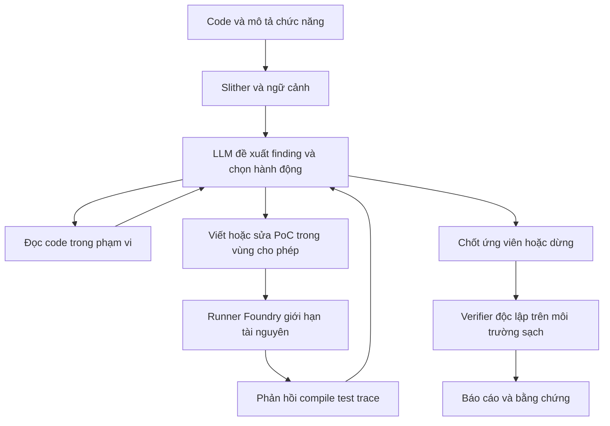

# Đề tài 2 — AI Agent hỗ trợ phát hiện lỗi logic và kiểm tra PoC bằng Foundry

> Phân tích ngày 23/10/2026, theo bối cảnh làm một mình, mới với bộ công cụ, làm toàn thời gian, ngân sách hạn chế và cần giải thích rõ bài toán. Những con số dưới đây là mục tiêu thiết kế, chưa phải kết quả đã đạt.

Ý tưởng ban đầu: **“Xây dựng và đánh giá AI Agent hỗ trợ phát hiện lỗi logic trong smart contract DeFi bằng phân tích tĩnh và kiểm chứng exploit trên Foundry.”**

Hướng này có chiều sâu kỹ thuật, nhưng phần khó nằm ở việc xác nhận lỗi và xây môi trường thử nghiệm, không chỉ ở viết vòng gọi công cụ. Với xuất phát điểm hiện tại, **nên giữ làm hướng mở rộng sau đề tài 1**, trừ khi vượt qua pilot ở mục 10.

Xem [đề tài 1](README.md) và [so sánh để lựa chọn](so_sanh.md).

## 1. Tên đề tài nên thu hẹp

Nếu vẫn chọn, đề xuất:

**Xây dựng và đánh giá tác tử LLM hỗ trợ phát hiện lỗi kế toán tài sản trong smart contract vault thông qua phân tích tĩnh và kiểm tra PoC trên Foundry.**

Một nhóm hợp đồng và một nhóm lỗi giúp giới hạn việc dựng môi trường, viết thuộc tính kiểm tra và giải thích kết quả. Không nên cam kết phát hiện mọi lỗi logic DeFi hoặc tự chứng minh mọi finding.

“Kiểm tra PoC” ở đây là thực thi một kịch bản trong môi trường thử nghiệm có kiểm soát, không phải chứng minh hình thức rằng hợp đồng an toàn hoặc rằng mọi trạng thái đã được xét.

## 2. Các khái niệm cần hiểu trước

| Khái niệm | Nghĩa trong đồ án | Ví dụ/giới hạn |
|---|---|---|
| Lỗi logic nghiệp vụ | Code chạy được nhưng vi phạm quy tắc thiết kế hoặc quyền lợi tài sản | Rút được nhiều tài sản hơn quyền sở hữu |
| Phân tích tĩnh | Xem cấu trúc/code mà không cần chạy kịch bản giao dịch cụ thể | Hàm gọi nhau, biến bị ghi, cảnh báo Slither |
| PoC | Kịch bản đủ nhỏ thể hiện nhận định về lỗi | Chuỗi nạp/rút làm phát sinh thâm hụt dưới điều kiện hợp lệ |
| Invariant | Thuộc tính được kỳ vọng giữ qua các thao tác hợp lệ | Trong mô hình đã định, tổng nghĩa vụ không vượt tài sản có thể chi trả |
| Test oracle | Quy tắc dùng để kết luận kết quả đúng/sai | So sánh tài sản và nghĩa vụ theo đặc tả được người làm kiểm tra độc lập |
| Agent | LLM quan sát phản hồi và chọn hành động tiếp theo trong một bộ công cụ có giới hạn | Đọc thêm hàm liên quan, sửa PoC, chạy lại hoặc dừng |
| Harness | Code dựng trạng thái, tác nhân và điều kiện kiểm tra | Token thử nghiệm, user, vault, tài sản ban đầu, verifier |

Ví dụ invariant trên chỉ phù hợp một mô hình đã nêu giả định; vault có chiến lược, nợ, phí hoặc tài sản ngoài contract cần công thức khác. Không lấy một bất đẳng thức đơn giản áp dụng cho mọi DeFi.

**Một workflow tuần tự có sẵn LLM → Slither → Foundry vẫn có thể chỉ là workflow.** Muốn gọi là Agent, phải mô tả rõ LLM được chọn hành động gì, quan sát gì, sửa gì và khi nào phải dừng. Không cần nhiều agent hay framework lớn để có tác tử tối thiểu này.

## 3. Bài toán thực sự có ba tầng

1. **Đề xuất lỗi:** đọc code, đặc tả trung lập và dữ liệu tĩnh để nêu giả thuyết có cơ sở.
2. **Tạo kịch bản:** chuyển giả thuyết thành thao tác có thể chạy trong harness.
3. **Xác nhận:** verifier độc lập kiểm tra kịch bản có thể hiện đúng vi phạm mục tiêu với quyền/tài sản hợp lệ hay không.

Nếu cung cấp sẵn mô tả lỗ hổng, vị trí và exploit tham chiếu cho Agent thì tầng 1 đã được giải hộ. Thí nghiệm khi đó chỉ đo **tái hiện lỗi đã biết**, cần đổi cách phát biểu bài toán và báo cáo riêng.

Nếu cung cấp một test mục tiêu tiết lộ chính xác lỗi, hệ thống cũng đang có thông tin mạnh hơn audit từ đầu. Đề tài nên có một chế độ chính không lộ lỗi: Agent nhận code, chức năng dự kiến và API harness; finding tham chiếu, patch và verifier cuối cùng được tách khỏi đầu vào.

### Vai trò của Slither

[Slither](https://github.com/crytic/slither) cung cấp detector; các [printer chính thức](https://github.com/crytic/slither/wiki/Printer-documentation) có thể xuất call graph, thông tin hàm và biến. Nó giúp tạo ngữ cảnh có cấu trúc, nhưng không tự suy ra đầy đủ ý định kinh doanh của mọi giao thức.

Không giới hạn Agent chỉ vào nơi Slither đã cảnh báo: lỗi logic cần tìm có thể không được detector bao phủ. Phải phân biệt cảnh báo có sẵn được diễn giải lại với finding do hệ thống đề xuất thêm.

### Vai trò của Foundry

Foundry giúp biên dịch, chạy unit test, fuzz/invariant test và quan sát trace. Theo [tài liệu invariant testing](https://getfoundry.sh/forge/invariant-testing?highlight=invariant), công cụ thử các chuỗi lời gọi ngẫu nhiên và kiểm tra thuộc tính sau thao tác. Kết quả phụ thuộc thuộc tính, trạng thái khởi tạo và phạm vi chạy; chạy xong không phát hiện lỗi chưa đủ kết luận an toàn.

Với 10 tuần, nên dùng **PoC dạng unit test xác định trước** làm đầu ra chính của Agent. Sinh handler/invariant và khám phá stateful fuzzing tự động là phần mở rộng riêng, không gom vào MVP.

## 4. Phạm vi MVP khả thi nhất nếu chọn

| Thành phần | Cam kết tối thiểu | Để sau |
|---|---|---|
| Miền | Vault đơn giản, lỗi tính tài sản/cổ phần | Lending, oracle, liquidation, cross-chain, MEV |
| Dữ liệu | Snapshot nhỏ, dependency khóa phiên bản, chạy local | Tự tải và dựng mọi repository |
| Công cụ tĩnh | Slither và trích ngữ cảnh tối thiểu | Viết engine phân tích tĩnh mới |
| Agent | Một tác tử, hành động giới hạn, log đầy đủ | Multi-agent, trình duyệt, shell tùy ý |
| Đầu ra | Finding + PoC + trace + trạng thái xác nhận | Tự vá và chứng minh bản vá đầy đủ |
| Thực thi | Harness offline là chính | Fork nhiều chain, giao dịch thật |
| Giao diện | CLI và trang báo cáo tĩnh/Markdown | Dashboard phức tạp |

Mỗi ca ban đầu ưu tiên 1–3 file nghiệp vụ chính. Không đánh đồng thành công trên một contract tối giản với audit được một protocol nhiều module.

Trên môi trường hiện tại là Windows/PowerShell, nên thử thống nhất toolchain trong WSL hoặc môi trường Linux có sẵn ngay tuần 1, thay vì học nhiều kiểu cài đặt cùng lúc. [Hướng dẫn Foundryup](https://getfoundry.sh/getting-started/installation?highlight=foundryup) có lưu ý về terminal hỗ trợ trên Windows. Đây là đề xuất chuẩn hóa môi trường, không giả định máy đã có WSL/Docker.

## 5. Kiến trúc và giới hạn quyền của Agent

Vòng lặp tối thiểu:

1. Chuẩn bị code và harness; chạy Slither cố định để thu dữ liệu đầu vào.
2. Agent đưa finding, điều kiện, thao tác thử và chọn hành động tiếp theo.
3. Chương trình thực thi đúng loại hành động được cho phép: đọc file, ghi phần PoC, chạy test, kết thúc.
4. Agent nhận phản hồi công khai, có thể sửa ứng viên trong giới hạn ngân sách.
5. Khi chốt, runner sạch kiểm tra bằng verifier độc lập; kết quả cuối không quay lại thành vòng tối ưu trên test set.

Gợi ý giới hạn ban đầu: **tối đa 4 lần gọi LLM và 4 lần chạy Foundry cho mỗi lượt; tối đa 5 phút tổng thời gian**, thêm timeout từng lệnh và trần token/tiền. Tất cả là tham số cần hiệu chỉnh trên development rồi khóa trước test. Lỗi hạ tầng được ghi riêng, không âm thầm thêm lượt.

Agent chỉ sửa vùng PoC được cấp. Code contract, dependency, harness tin cậy và verifier không được sửa. Cài dependency trước batch; runner không cần truy cập mạng hay khóa ví thật. Về kỹ thuật, runner nên thực thi trong môi trường tách biệt, giới hạn CPU/RAM/thời gian và chỉ cung cấp các file cần thiết.

Phản hồi cho Agent và phép chấm cuối phải được mô tả riêng. Harness công khai có thể cho biết setup và cách gọi hàm, nhưng không chứa tên lỗi hoặc oracle tiết lộ đáp án. Không cho Agent đọc thư mục nhãn, exploit mẫu hay code bản vá.

## 6. Vì sao “test chạy được” chưa đủ chứng minh exploit?

| Quan sát | Đủ kết luận chưa? | Kiểm tra còn thiếu |
|---|---|---|
| Code PoC biên dịch | Chưa | Có gọi đúng contract và tác động thật không? |
| Test báo PASS | Chưa | Assertion có kiểm tra thiệt hại hay chỉ kiểm tra `true`? |
| Test bị revert/FAIL | Chưa | Là hành vi sai mong muốn hay chỉ thiếu approve/setup? |
| Invariant bị vi phạm | Chưa chắc là exploit | Invariant đúng đặc tả không, trạng thái và actor có hợp lệ không? |
| Attacker tăng balance | Chưa | Có tính tiền cấp ban đầu, khoản vay phải trả và chuyển tài sản do setup không? |
| Vi phạm đúng đặc tả với điều kiện hợp lệ, replay được | Có bằng chứng cho kịch bản này | Vẫn không chứng minh bao phủ mọi trạng thái hoặc mọi lỗi |

Một PoC hợp lệ cần chứng minh:

- Quyền và tài sản ban đầu khớp mô hình đe dọa; attacker không tự được cấp quyền admin ngoài giả định.
- Chuỗi thao tác đi qua các entry point thực sự được mở cho actor đó.
- Số liệu trước/sau thể hiện lỗi nghiệp vụ, ví dụ phần tài sản rút vượt quyền sở hữu hoặc thiệt hại của người gửi khác.
- Phép tính lợi ích trừ tài sản ban đầu và nghĩa vụ phải trả; nêu rõ nếu chưa mô phỏng gas hoặc chi phí kinh tế khác.
- Cùng kịch bản chạy trong môi trường sạch và đạt kiểm tra cuối của verifier.
- Trên bản sửa, kịch bản không còn tạo vi phạm mục tiêu, trong khi các test hành vi hợp lệ vẫn chạy. Nếu không áp dụng nguyên xi được, mô tả khác biệt và không tính tùy tiện là thành công.

**Ngăn test gian lận:** `deal` chỉ cấp vốn setup cố định, không bơm tiền sau hành động để tạo lợi nhuận giả. `prank` chỉ đóng vai actor được mô hình cho phép. Không cho Agent dùng `vm.store`, `etch`, sửa oracle/mock, tắt assertion hoặc thay verifier để ép kết quả. Quy tắc có thể khác theo ca, nhưng phải định trước và kiểm tra bằng bộ phận tin cậy. Kiểm tra regex đơn giản không thay thế được cách ly và verifier đúng.

Trạng thái cuối nên tách: `validated`, `plausible_unconfirmed`, `rejected`, `build_error`, `timeout`, `infrastructure_error`. Chưa tái hiện được không đồng nghĩa nhận định sai; hết ngân sách không đồng nghĩa contract an toàn.

## 7. Dữ liệu và harness là nút thắt chính

3.000 Markdown hiện có trong workspace là nguồn đọc finding, **chưa phải 3.000 môi trường exploit chạy được**. Mỗi ca của hướng này cần thêm compiler, dependency, snapshot code, setup tài sản, actor, verifier và test hành vi bình thường. Đôi khi cần địa chỉ và state lịch sử nếu dùng fork.

Nguồn tham khảo gốc:

- [DeFiVulnLabs](https://github.com/SunWeb3Sec/DeFiVulnLabs): ca học lỗi bằng Foundry, phù hợp luyện kỹ năng và development; nhãn hoặc exploit thường có sẵn nên phải tách khỏi đầu vào khi đánh giá.
- [DeFiHackLabs](https://github.com/SunWeb3Sec/DeFiHackLabs): tái hiện sự cố bằng Foundry; nhiều ca gắn môi trường lịch sử, cần kiểm tra từng ca trước khi chọn.
- [Dataset GPTScan](https://github.com/GPTScan/GPTScan): ứng viên lỗi logic; phải tự kiểm tra khả năng dựng harness, không mặc định có PoC sẵn phù hợp.

Nếu dùng fork, cố định chain ID, block, địa chỉ, compiler và dependency; kiểm tra RPC còn trả được state lịch sử cần thiết. [Anvil](https://www.getfoundry.sh/anvil/index.html) hỗ trợ fork tại block xác định, nhưng không tự bảo đảm endpoint của bạn cung cấp mọi state. Hướng local giúp giảm phụ thuộc RPC cho MVP.

### Quy mô mục tiêu

Khoảng **12 ca gốc**, ưu tiên 8 ca có nguồn thực tế và 4 ca tối giản có kiểm soát; mỗi ca có bản lỗi/bản sửa cho lỗi mục tiêu: 24 đầu vào. Chia theo project thành khoảng 4 ca gốc development và 8 ca gốc test, điều chỉnh số lượng để không lẫn project. Đây là mục tiêu, chưa xác nhận đã có đủ ca dùng được.

Phải lưu loại ca: nguyên dự án, trích xuất/rút gọn hay tự xây. Báo kết quả riêng cho ca thật và ca tối giản. Nhiều biến thể sinh từ cùng template không thay thế được tính đa dạng của nguồn thực tế.

Áp dụng quy tắc chống lộ đáp án như [đề tài 1](README.md): tách theo project và code gần trùng; không đưa báo cáo/PoC/bản sửa của ca test vào prompt, bộ nhớ Agent hoặc kho RAG. Không cho bản lỗi vào development và bản sửa của cùng ca vào test.

## 8. Thiết kế đánh giá để biết Agent có ích thật không

### Câu hỏi và cấu hình so sánh

| Cấu hình | Đầu vào và cách làm | Mục đích |
|---|---|---|
| B0 | Code + đặc tả; LLM sinh finding/PoC một lần, runner kiểm tra cuối | Baseline LLM trực tiếp |
| B1 | B0 + dữ liệu Slither; vẫn sinh một lần, không sửa theo phản hồi | Đo ảnh hưởng ngữ cảnh tĩnh |
| B2 | Cùng dữ liệu B1 + Agent nhận phản hồi và sửa trong tối đa 4 lượt | Đo hiệu quả thực tế của vòng phản hồi |
| B3 | Cùng dữ liệu B1, sinh tối đa 4 ứng viên độc lập, không nhận phản hồi để sửa | Đối chứng việc B2 được cấp thêm lượt thử |

Tất cả dùng cùng model, code, đặc tả, harness, verifier và chính sách chấm. B0/B1 không nhận thêm gợi ý ẩn mà B2 không có. B2 và B3 dùng cùng trần tổng token, số lần thử và thời gian; báo ngân sách thực dùng, không chỉ trần lý thuyết. Với B3, runner chấm từng ứng viên độc lập và báo có ít nhất một ứng viên hợp lệ, không đưa kết quả về cho model.

Nếu thiếu nguồn lực chạy B3 toàn bộ, làm trên một tập con được chọn trước khi xem kết quả và nêu giới hạn. **Không có đối chứng ngân sách thì chỉ được nói cấu hình Agent nhiều lượt hiệu quả ra sao; chưa tách được lợi ích phản hồi khỏi lợi ích thử nhiều lần.**

Có thể chạy Slither riêng để báo số lỗi tham chiếu nó tìm thấy, nhưng không so điểm “PoC thành công” với Slither vì Slither không được thiết kế để sinh PoC.

### Chỉ số chính

- **Tỷ lệ tìm được lỗi có PoC hợp lệ:** số ca lỗi mục tiêu được tìm và xác nhận / tổng ca lỗi mục tiêu. Nêu rõ mẫu số là ca có lỗi trong test set.
- **Độ chính xác của finding:** chấm theo cơ chế, điều kiện, tác động như đề tài 1; chưa xác nhận mang nhãn riêng, không biến mọi timeout thành FP.
- **Tỷ lệ dựng được PoC sau khi tìm đúng lỗi:** phân tích có điều kiện, giúp tách lỗi suy luận khỏi lỗi tạo test; không dùng thay chỉ số đầu-cuối.
- Tỷ lệ cảnh báo lại lỗi mục tiêu trên bản sửa; mức phát hiện phụ thuộc harness.
- Tỷ lệ compile, tỷ lệ verifier chấp nhận trong các ứng viên đã compile; báo cả mẫu số để tránh làm đẹp tỷ lệ.
- Số lượt, token, tiền, thời gian trung vị và ca chậm; tách compile/dependency/RPC lỗi.
- Số finding không có xác nhận và mức can thiệp của người làm.

Với mục tiêu 16 đầu vào test, 4 cấu hình và 3 lần lặp: 192 lượt thử cấu hình. Nếu B0/B1 tối đa một cuộc gọi, B2/B3 tối đa bốn cuộc gọi, trần cuộc gọi chính là `16 × 3 × (1 + 1 + 4 + 4) = 480`, chưa kể development, retry và lần chạy Slither. Có thể giảm sau pilot theo ngân sách nhưng phải khóa trước thí nghiệm.

Nhóm kết quả theo ca gốc/project, công bố dao động giữa các lần. Mẫu nhỏ không đủ kết luận tổng quát cho mọi smart contract DeFi. Mọi sửa harness sau khi thấy kết quả test phải được ghi, xem là thay đổi benchmark và chạy lại cấu hình liên quan cho công bằng.

## 9. Tính mới và nội dung có thể bảo vệ

[GPTScan](https://arxiv.org/abs/2308.03314) đã kết hợp LLM với phân tích chương trình cho lỗi logic. [PropertyGPT](https://arxiv.org/abs/2405.02580) đã nghiên cứu sinh thuộc tính có truy xuất, dùng phản hồi biên dịch/phân tích và bộ chứng minh. Đây là các tiền lệ liên quan, không phải cùng một hệ thống Foundry như kế hoạch này. Không tuyên bố “đầu tiên dùng AI cho audit” hoặc lấy từ Agent làm bằng chứng tính mới.

Đóng góp phù hợp: thiết kế vòng phản hồi giới hạn, verifier tránh PoC giả, bộ ca tái lập và so sánh với sinh một lần/sinh nhiều ứng viên cùng ngân sách. Mỗi thành phần phải giải thích được bằng ví dụ cụ thể.

Các câu giảng viên có thể hỏi sâu:

| Câu hỏi | Điều phải chứng minh |
|---|---|
| Thuộc tính này do ai đặt, có đúng nghiệp vụ không? | Nguồn đặc tả, giả định và test hành vi hợp lệ |
| Vì sao test PASS chứng minh được lỗi? | Verifier kiểm tra đúng vi phạm; PoC không thao túng setup/assertion |
| Agent thông minh ở đâu? | Hành động được chọn theo phản hồi, với log và giới hạn rõ |
| Lợi ích do phản hồi hay do thử nhiều lần? | So B2/B3 cùng ngân sách |
| Có phải chỉ sao chép exploit đã biết? | Không đưa đáp án vào đầu vào; nêu giới hạn dữ liệu công khai và model ghi nhớ |
| Không tìm ra exploit thì contract an toàn chưa? | Chưa; chỉ chưa tìm thấy trong phạm vi và ngân sách đã thử |

## 10. Lịch 10 tuần và điều kiện tiếp tục

| Tuần | Việc chính | Bằng chứng tiến độ |
|---|---|---|
| 1 | Học Solidity/Foundry, vault đơn giản | Tự giải thích và viết được 2 unit test bình thường, 1 kịch bản lỗi nhỏ |
| 2 | Pilot tích hợp và chọn ca | ≥3 ca nguồn công khai build/run được; 1 harness có verifier độc lập; 1 vòng LLM → test → phản hồi → sửa chạy được |
| 3 | Chuẩn hóa harness/dataset và tách tập | Chốt phạm vi, nguồn code, bản sửa, mô hình actor; nhãn tách khỏi đầu vào |
| 4 | Slither và B0/B1 | Phân biệt cảnh báo công cụ với finding mới; đo baseline trên development |
| 5 | B2 có giới hạn | Log hành động, quota, trạng thái dừng, không sửa verifier/contract |
| 6 | B3 và kiểm tra phép chấm | Khóa dữ liệu, prompt, ngân sách; kiểm tra replay và đối chứng bản sửa |
| 7 | Thí nghiệm chính | Kết quả và tài nguyên từng lượt |
| 8 | Kiểm tra PoC, phân tích thất bại | Phân biệt sai giả thuyết, sai setup, sai assertion, hết ngân sách |
| 9 | Luận văn và demo | Trình bày được dòng tiền trước/sau và bằng chứng của từng ca demo |
| 10 | Dự phòng, hoàn thiện, luyện bảo vệ | Demo local ổn định và log/video dự phòng |

**Pilot tuần 2 là mốc kiểm tra khả năng tiếp tục:** phải vừa giải thích được lỗi, vừa có hệ thống tối thiểu chạy được. Nếu cần người khác hoặc công cụ AI dựng toàn bộ harness mà bản thân không hiểu cách xác nhận, chưa đáp ứng yêu cầu giảng viên dù demo có chạy.

Cuối tuần 3 chưa có bộ ca đủ đa dạng hoặc cuối tuần 5 vòng phản hồi vẫn không ổn định: dừng mở rộng, quay về phạm vi đề tài 1 hoặc đổi thành “hỗ trợ tái hiện lỗi đã biết” nếu được giảng viên chấp nhận cách phát biểu mới. Không kéo việc học nền tảng đến tuần 7 rồi mới bắt đầu thí nghiệm.

## 11. Chi phí và rủi ro riêng của hướng này

Chi phí API tính theo [công thức ở đề tài 1](README.md), nhưng mỗi lượt còn có trace, prompt lặp, code PoC và nhiều lần sửa. Trần 480 cuộc gọi không tự cho biết tổng tiền: phải đo số token và giá model thực dùng. Không mặc định chỉ đắt hơn bốn lần vì độ dài ngữ cảnh mỗi vòng có thể tăng.

Tài nguyên cần dự trù thêm gồm thời gian build/test, dung lượng dependency, công sửa harness và khả năng cần RPC có state lịch sử. Làm local giảm phụ thuộc dịch vụ, nhưng không giảm công hiểu nghiệp vụ và thiết kế oracle.

| Rủi ro | Dấu hiệu sớm | Cách thu hẹp |
|---|---|---|
| Chưa hiểu Solidity/DeFi | Không tự tính được tài sản trước/sau | Một loại vault, một nhóm lỗi, ca tối giản có giải thích |
| Dựng môi trường quá lâu | Nhiều ca vướng compiler/import/RPC | Khóa phiên bản, chọn ca local có dependency rõ |
| PoC giả hoặc vô nghĩa | PASS nhưng không có vi phạm được kiểm tra | Verifier độc lập, whitelist thao tác, đối chứng bản sửa |
| Agent lặp vô ích | Sửa mãi cùng một lỗi compile | Trần lượt/thời gian/tiền và trạng thái chưa xác nhận |
| Benchmark quá dễ/lộ nhãn | Chỉ chạy ví dụ có tên lỗi/PoC gốc | Tách nguồn đáp án, giữ test chưa dùng chỉnh hệ thống |
| Không đủ dữ liệu | Nhiều biến thể cùng một template | Giảm độ rộng kết luận, ưu tiên nguồn khác nhau |

**Đánh giá cho trường hợp của bạn:** có thể học được nhiều, nhưng cần hiểu đồng thời nghiệp vụ, phân tích tĩnh, test oracle, toolchain và hành vi Agent. Khả năng làm toàn thời gian giúp có thêm giờ; chưa loại bỏ được chuỗi phụ thuộc kỹ năng và rủi ro dữ liệu. Vì vậy hướng này phù hợp hơn khi đã có nền tảng hoặc được người có kinh nghiệm hỗ trợ phần harness.

## 12. Sản phẩm bàn giao dự kiến

- Tác tử với policy công cụ, quota, log và cách chạy lại.
- Bộ ca có snapshot/dependency, mô tả, verifier và nhãn tách riêng.
- PoC được chấp nhận/từ chối kèm lý do; trace và đối chứng bản sửa.
- Thí nghiệm B0–B3 trong phạm vi nguồn lực, báo cáo can thiệp và lỗi hạ tầng.
- Luận văn giải thích được vì sao xác nhận đúng một kịch bản, giới hạn bao phủ và lợi ích thực của vòng phản hồi.

Các thành phần này chưa được triển khai trong repository. Phân tích dùng dữ liệu hiện có và tài liệu gốc được dẫn tại từng mục; chưa có nội dung các đoạn chat khác để kiểm chứng nhận định trong các cuộc trao đổi đó.
