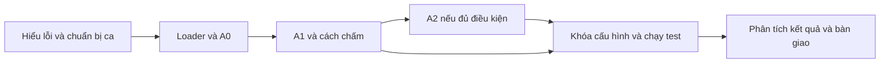
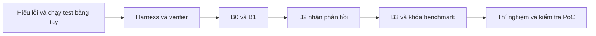

# Phương án triển khai theo giai đoạn cho hai đề tài

> Lập ngày 23/10/2026. Kế hoạch dành cho một người làm toàn thời gian trong khoảng 10 tuần, còn mới với Solidity/DeFi/Foundry và có ngân sách hạn chế, theo bối cảnh đã ghi trong các tài liệu đề tài.
>
> Các số lượng ca, module, thư mục và mốc nghiệm thu dưới đây là **mục tiêu triển khai**, chưa phải thành phần đã hoàn thành. Tuần 1 bắt đầu khi bắt tay làm, không mặc định bắt đầu vào ngày lập tài liệu.

**Có thể bắt đầu với đề tài 1 ngay: làm một luồng code → finding → báo cáo chạy được, sau đó mới thêm truy xuất. Nếu chọn đề tài 2, cần ưu tiên dựng harness và verifier trước vòng lặp Agent.** Hai lộ trình dưới đây là hai lựa chọn cho cùng quỹ 10 tuần; không cộng thành cam kết làm cả hai đề tài.

Tài liệu này cụ thể hóa [đề tài 1](README.md), [đề tài 2](De_tai_phu.md) và [bản so sánh](so_sanh.md). Phần xử lý kho finding dựa trên [phân tích dữ liệu](phan_tich_du_lieu.md); phần truy xuất tham khảo [phương án embedding](Cac_phuong_phap_embedding.md).

## 1. Điểm xuất phát và nguyên tắc triển khai

### 1.1. Những gì đang có và việc cần làm tiếp

| Thành phần hiện có | Có thể dùng vào việc gì? | Phần còn phải xây |
|---|---|---|
| `rag_output_last_3000/`, `md_rag_output_last_3000/` | Đọc finding, chọn nhóm lỗi, tìm nguồn code, dựng kho tri thức | Snapshot code đúng phiên bản, nhãn tham chiếu, bản đối chứng; harness nếu chọn đề tài 2 |
| [Kiểm kê dữ liệu](analysis/dataset_quality_summary.json) | Xem cấu trúc và vấn đề chất lượng của snapshot đã phân tích | Quy trình chuẩn hóa và thẩm định các bản ghi thực sự được chọn |
| [Script kiểm kê](tools/analyze_dataset.mjs) | Kiểm kê lại khi dữ liệu thay đổi | Chưa thay thế bước đọc hiểu và xác nhận nội dung |
| [Script thử BM25](tools/probe_dataset_retrieval.mjs) | Tham khảo tokenizer và luồng truy xuất đơn giản | Index đã lọc, bộ query độc lập, kiểm tra rò rỉ và đánh giá retrieval |
| [Demo đề tài 1](demos/de_tai_1.html), [demo đề tài 2](demos/de_tai_2.html) | Tham khảo cách trình bày đầu ra | Backend và kết quả thực; hiện các demo dùng kịch bản mô phỏng |

Khoảng 3.000 finding không đồng nghĩa với 3.000 ca audit hoặc exploit chạy được. **Tìm code đúng phiên bản và thiết kế cách chấm phải đi cùng quá trình lập trình**, không chờ hệ thống xong mới làm dữ liệu.

### 1.2. Phạm vi khởi đầu cho cả hai hướng

- Chọn một nhóm lỗi: sai lệch kế toán tài sản/cổ phần ở vault đơn giản. Chỉ thêm staking khi đủ dữ liệu và tiến độ cho phép.
- Mỗi ca ưu tiên 1–3 file nghiệp vụ chính, khoảng 200–800 dòng cần đọc; vẫn cung cấp dependency hoặc ngữ cảnh liên quan nếu cần hiểu đúng.
- Viết rõ actor, tài sản, quyền, thao tác hợp lệ và quy tắc mong muốn của từng ca. Không mặc định mọi vault đều theo cùng một chuẩn.
- Dùng một model LLM cho thí nghiệm chính, chọn sau pilot; chưa fine-tune và chưa xây multi-agent.
- Làm CLI và JSON/Markdown trước. Chỉ nối giao diện khi luồng xử lý và cách chấm đã ổn.
- Viết luận văn từ tuần 1: mỗi tuần cập nhật phần tương ứng và ghi quyết định, thất bại, chi phí.

**Ca gốc** là một tình huống lỗi độc lập, có thể có hai phiên bản: còn lỗi và đã sửa lỗi mục tiêu. Hai phiên bản không được tính thành hai nguồn lỗi độc lập. Bản đã sửa cũng không có nghĩa là hợp đồng an toàn với mọi loại lỗi.

### 1.3. Cấu trúc triển khai đề xuất

Giữ các tài liệu và dữ liệu gốc hiện có, bổ sung dần cấu trúc sau khi bắt đầu lập trình. Chỉ tạo phần cần cho đề tài đã chọn.

```text
configs/                  Cấu hình model, giới hạn, A0–A2 hoặc B0–B3
prompts/                  Prompt có phiên bản, dùng chung schema đầu ra
schemas/                  Schema đầu vào, finding, hành động và kết quả chạy
src/
  data/                   Chuẩn hóa finding, kiểm tra manifest, chia tập
  llm/                    Gọi model, kiểm tra đầu ra, ghi usage và lỗi
  audit/                  Chọn ngữ cảnh, chạy A0/A1/A2, xuất báo cáo
  retrieval/              Chunk, BM25; dense/hybrid nếu được chọn
  evaluation/             Ghép finding, nhập kết quả chấm, tổng hợp chỉ số
  agent/                  Chọn và điều phối hành động; riêng đề tài 2
  runner/                 Chạy công cụ và verifier; riêng đề tài 2
data/
  normalized/             Finding chuẩn hóa, có nguồn và hash
  knowledge/              Corpus đã lọc dùng cho retrieval
  benchmark/
    inputs/               Code và mô tả trung lập được cấp cho model
    manifests/            Nguồn, commit/hash, nhóm project và chia tập
    labels/               Nhãn tham chiếu; chỉ bên đánh giá được đọc
cases/                    Dependency, harness và verifier cho đề tài 2
runs/                     Kết quả gốc, prompt thực gửi, usage và log từng lượt
reports/                  Bảng kết quả, phân tích lỗi và báo cáo cuối
```

`inputs/` nên dùng mã ca trung lập; không đưa tên thư mục như `vulnerable`/`fixed`, patch diff, exploit mẫu hoặc metadata tiết lộ nhãn vào ngữ cảnh model. Loại comment chỉ rõ lỗi và test exploit có sẵn khỏi đầu vào; giữ lại mô tả chức năng cần thiết. Việc đặt nhãn ở thư mục riêng phải đi kèm giới hạn file mà loader/Agent được đọc; chỉ tách tên thư mục chưa đủ ngăn lộ đáp án. Ghi nhận model vẫn có thể đã biết code/báo cáo công khai từ huấn luyện.

Python phù hợp để viết pipeline chung; hai script Node.js đang có có thể tiếp tục dùng cho kiểm kê. Với đề tài 2, thử thống nhất Foundry/Slither/runner trong WSL hoặc môi trường Linux sẵn có ngay tuần 1, kiểm tra trên máy thực tế trước khi chốt. Không coi WSL đơn thuần là cơ chế cách ly đủ cho mã do model sinh.

### 1.4. Quy ước dữ liệu và log cần đặt từ đầu

Mỗi ca có hai phần tách biệt:

| Phần | Nội dung tối thiểu |
|---|---|
| Đầu vào model | Mã ca trung lập, code snapshot, phạm vi file/hàm, mô tả chức năng và giả định nghiệp vụ |
| Manifest quản lý | Project, nguồn finding, commit hoặc hash snapshot, nguồn bản sửa, compiler/dependency nếu cần, loại ca, nhóm gần trùng, development/test |
| Nhãn chỉ để chấm | Nguyên nhân gốc, vị trí, điều kiện, tác động, lập luận tham chiếu, lỗi mục tiêu đã sửa hay chưa |
| Bổ sung cho đề tài 2 | Actor, vốn/quyền ban đầu, API harness, verifier độc lập, test hành vi hợp lệ và cách dựng lại môi trường |

Nếu tự tạo bản sửa hoặc tự rút gọn code, ghi rõ người thực hiện, thay đổi và cách kiểm tra. Không trình bày bản sửa tự viết như bản vá chính thức của dự án.

Mỗi lượt chạy lưu `run_id`, mã ca, cấu hình, lần lặp, model ID, tham số sinh, phiên bản prompt/schema, hash đầu vào/corpus, output gốc, kết quả parse, usage, thời gian, chi phí và lỗi/retry. Nếu có retrieval, lưu query và ID đoạn đã lấy; nếu có Agent, lưu từng hành động, phản hồi công cụ, PoC, trace và trạng thái cuối.

Đầu ra finding dùng các trường trong [đề tài 1](README.md): vị trí, nguyên nhân, điều kiện, tác động, bằng chứng, khuyến nghị, nguồn và trạng thái. `findings: []` là đầu ra hợp lệ. Phân biệt bằng chứng suy luận từ code với bằng chứng đã thực thi; không tự gắn trạng thái xác nhận chỉ vì model viết tự tin.

## 2. Đề tài 1 — LLM hỗ trợ rà soát và lập báo cáo finding

### 2.1. Đích cần đạt và thứ tự xây

**Đích tối thiểu:** một pipeline nhận snapshot code và mô tả nghiệp vụ, chạy A0 hoặc A1, xuất finding JSON/Markdown, sau đó so sánh trên bộ ca khóa trước. A2 có truy xuất là phần mở rộng có điều kiện.



Không cần hoàn thành toàn bộ kho RAG mới làm A0. Luồng đầu tiên nên chỉ dùng một ca development nhỏ và một lời gọi model.

### 2.2. Giai đoạn 1: hiểu bài toán và làm ca mẫu — tuần 1

**Mục tiêu:** tự giải thích được lỗi trước khi yêu cầu LLM tìm lỗi.

1. Học các phần Solidity dùng trong ca mẫu: state, function, modifier, call, số nguyên, phép chia và quyền gọi hàm. Học vault qua thao tác nạp/rút và quy đổi tài sản–cổ phần.
2. Chọn hai finding đơn giản để đọc; ít nhất một finding thuộc nhóm vault đã chọn. Vẽ actor và dòng tài sản, tính trạng thái trước/sau bằng tay.
3. Với một ca tối giản, tạo bản lỗi và bản sửa lỗi mục tiêu. Viết mô tả chức năng trung lập riêng với lời giải tham chiếu.
4. Dùng Foundry ở mức cơ bản để chạy test hành vi hợp lệ và một kiểm tra lỗi nếu dựng được. Đây là hỗ trợ hiểu ca, chưa phải xây Agent hoặc yêu cầu mọi ca đều có PoC.
5. Viết một trang xác định đầu vào, đầu ra, nhóm lỗi, phạm vi và câu hỏi nghiên cứu: A1 có thay đổi chất lượng finding so với A0 hay không?

**Bàn giao:** đặc tả phạm vi một trang, hai bản phân tích lỗi bằng tay, một ca development mẫu có nguồn hoặc đánh dấu tự xây, schema finding bản đầu.

**Qua giai đoạn khi:** có thể chỉ ra dòng code, điều kiện, phép tính sai và người chịu tác động mà không cần đọc lại câu trả lời LLM. Nếu chưa đạt, giảm ca về mô hình ít actor và ít trạng thái hơn.

### 2.3. Giai đoạn 2: xây bộ ca và tách tập — tuần 2 đến hết tuần 3

**Mục tiêu:** có dữ liệu đánh giá từ code, không chỉ có văn bản báo cáo.

1. Lọc finding ứng viên bằng từ khóa như vault, shares, deposit, withdraw và rounding; đọc lại để xác nhận đúng nhóm lỗi. Dùng metadata hiện có để tìm nguồn, không coi tag thiếu hoặc tag tự suy ra là nhãn chuẩn.
2. Lần về báo cáo gốc và code tương ứng. Ghi commit nếu xác định được; nếu dùng snapshot khác, phải có bằng chứng nó chứa lỗi và ghi hash, không lấy nhánh mới nhất thay thế tùy tiện.
3. Với mỗi ca được nhận, hoàn thành code, mô tả trung lập, nhãn nguyên nhân–điều kiện–tác động và bản đối chứng đã sửa lỗi mục tiêu. Ca thiếu bằng chứng phiên bản giữ ở danh sách ứng viên, chưa đưa vào benchmark.
4. Gắn loại ca: code dự án, rút gọn từ dự án hoặc tự xây. Gộp các fork, bản sao và ca cùng template thành nhóm trước khi chia tập.
5. Cuối tuần 2 hướng đến ít nhất 6 ca gốc dùng được, ưu tiên ít nhất 3 ca từ nguồn thực tế. Sau đó tiếp tục thu thập để cuối tuần 4 chốt bộ tối thiểu.
6. Chia development/test theo project và nhóm gần trùng; hai phiên bản của một ca luôn cùng tập. Chỉ development được dùng để chỉnh prompt, chọn context và thử cách chấm.

| Quy mô | Kế hoạch |
|---|---|
| Mục tiêu | 16 ca gốc: khoảng 10 ca nguồn thực tế và 6 ca tối giản có kiểm soát |
| Chia tập dự kiến | 4 ca gốc development, 12 ca gốc test; tương ứng 8 và 24 đầu vào nếu mỗi ca đủ hai bản |
| Mức tối thiểu sau thu gọn | 12 ca gốc, ưu tiên ít nhất 8 ca nguồn thực tế; chốt lại số development/test theo nhóm project |

Các số chia tập là mục tiêu; ưu tiên không lẫn project hơn giữ đúng tỷ lệ. Chọn ca theo điều kiện dữ liệu đã đặt, không theo việc model có tìm được lỗi hay không.

**Bàn giao:** manifest có nguồn và hash, đầu vào model tách nhãn, danh sách chia tập, danh sách ca bị loại kèm lý do.

**Mốc thu hẹp:** cuối tuần 2 chưa đủ 6 ca thì bỏ nhóm lỗi thứ hai và giảm độ lớn snapshot. Cuối tuần 4 chưa đạt mức tối thiểu thì ưu tiên bổ sung dữ liệu, bỏ UI và các mở rộng; nếu vẫn thiếu, điều chỉnh phạm vi kết luận và đề cương với giảng viên.

### 2.4. Giai đoạn 3: làm luồng A0 chạy từ đầu đến cuối — tuần 3

**Mục tiêu:** một ca đi qua hệ thống thật và có thể truy vết kết quả.

Triển khai theo thứ tự:

| Thứ tự | Module | Hành vi phải có |
|---|---|---|
| 1 | Loader | Đọc đúng snapshot, giữ số dòng và phạm vi; không đọc nhãn, phiên bản đối ứng hoặc patch diff của ca đang phân tích |
| 2 | Context builder | Chọn code theo quy tắc cố định, kiểm tra giới hạn context; báo thiếu dữ liệu thay vì cắt âm thầm |
| 3 | LLM client | Nhận cấu hình model, timeout và trần token; lưu response, usage, lỗi và chi phí |
| 4 | A0 | Một prompt trực tiếp yêu cầu tìm lỗi trong phạm vi và trả cùng schema finding |
| 5 | Validator | Kiểm tra JSON, trường bắt buộc, file/hàm/vùng dòng tồn tại; chưa kết luận finding đúng về ngữ nghĩa |
| 6 | Report renderer | Từ JSON tạo Markdown có finding, bằng chứng, giới hạn và metadata lượt chạy |

Chạy một ca development trước, sau đó một bản đã sửa. Kiểm tra cả trường hợp không có finding và output sai schema. Cho phép tối đa một retry vì lỗi định dạng/vận chuyển theo chính sách cố định, có log; không biến retry thành vòng phản biện nội dung ngầm.

**Bàn giao:** CLI nội bộ chạy một ca với A0, JSON/Markdown và log thật. Cú pháp CLI sẽ được định nghĩa lúc lập trình; hiện repository chưa có lệnh audit hoàn chỉnh.

**Qua giai đoạn khi:** có thể lần từ một finding về đúng input, model, prompt và output gốc; lỗi parse hoặc vị trí không hợp lệ được thể hiện rõ. Chưa cần giao diện và chưa cần retrieval.

### 2.5. Giai đoạn 4: A1 và quy trình chấm — tuần 4

**Mục tiêu:** tạo khác biệt có thể kiểm tra giữa prompt trực tiếp và phân tích có cấu trúc.

1. Viết prompt A1 hướng dẫn xác định actor, dòng tài sản, trạng thái, quy tắc nghiệp vụ, tình huống biên và bằng chứng cho mỗi finding. Yêu cầu lời giải thích kiểm tra được, không yêu cầu suy nghĩ nội bộ của model.
2. Giữ A0/A1 cùng model, code, mô tả, schema, giới hạn finding và ngân sách sinh; mỗi cấu hình vẫn một cuộc gọi chính. Ghi nhận chênh lệch độ dài prompt.
3. Chạy trên development; sửa lỗi loader/schema trước khi tối ưu hướng dẫn. Nếu phải thay context, áp dụng lại cho cả A0 và A1.
4. Viết rubric chấm nguyên nhân, vị trí/cơ chế, điều kiện khả thi và tác động. Chuẩn bị ví dụ finding đúng, sai, trùng và chưa xác minh.
5. Làm bảng chấm thủ công trước; module đánh giá ban đầu chỉ cần hỗ trợ nhập nhãn, ghép kết quả và tổng hợp. Không cần tự động hóa toàn bộ việc chấm bằng LLM.
6. Hoàn tất bộ ca tối thiểu và khóa chia tập. Người chuẩn bị dữ liệu có thể đọc nhãn, nhưng không dùng kết quả chạy test để điều chỉnh hệ thống.

**Bàn giao:** prompt A0/A1 có phiên bản, rubric, bảng kết quả development và bộ ca đã chốt.

**Qua giai đoạn khi:** có thể giải thích vì sao một finding được chấm đúng hoặc sai bằng code và nhãn; hiểu rằng schema hợp lệ và chỉ đúng số dòng chưa chứng minh nhận định hợp lệ.

### 2.6. Giai đoạn 5: thêm A2 có truy xuất — tuần 5, chỉ khi phần lõi đã ổn

**Mục tiêu:** đo tri thức tham khảo có giúp thêm so với A1 hay không.

1. Chuẩn hóa từ JSON gốc, giữ raw hash và nguồn. Bắt đầu với 50–100 finding đã đọc kiểm tra; chỉ mở rộng lên khoảng 100–300 finding đúng phạm vi khi có ích.
2. Loại báo cáo, fork và bản sao cùng sự cố của project test khỏi corpus. Khi thử trên development, cũng loại nguồn đáp án của chính ca/project đang thử. Lưu danh sách loại và lý do.
3. Chunk theo mạch mô tả–cơ chế–điều kiện, gắn `parent_id`, ID chunk và nguồn; tách rõ PoC, mitigation và trạng thái đã sửa. Không để nhiều chunk của một finding chiếm toàn bộ top kết quả.
4. Dựng BM25 trước. Query phải sinh từ code/mô tả được phép dùng bằng một quy tắc cố định; không dùng tên lỗi hoặc finding tham chiếu làm query.
5. Tạo một bộ query nhỏ có relevance được đọc kiểm tra, gồm câu gần nghĩa và câu không có bằng chứng. Tách phần dùng chỉnh retriever với phần kiểm tra; chỉ số retrieval không thay thế chỉ số phát hiện lỗi.
6. Chỉ thử một nhánh dense/hybrid theo [tài liệu embedding](Cac_phuong_phap_embedding.md) nếu BM25 gặp vấn đề đã quan sát và còn thời gian. Ghi model/revision, tokenizer, chunk và hash index; chưa cần dịch vụ vector database.
7. A2 dùng prompt phân tích của A1 và tối đa 3 finding tham khảo, có nguồn. Lưu tài liệu thực sự đưa vào context cùng token tăng thêm.

**Bàn giao:** corpus đã lọc, script dựng index, log truy xuất, prompt A2 và kết quả pilot trên development.

**Mốc thu hẹp:** cuối tuần 5 retrieval vẫn nhiễu hoặc chưa kiểm soát được lộ đáp án thì giữ A0/A1 làm thực nghiệm chính. Không cần thêm hàng loạt model embedding; có thể báo RAG là thử nghiệm phụ hoặc bỏ khỏi phạm vi đã chốt với giảng viên.

### 2.7. Giai đoạn 6: khóa cấu hình và chạy thí nghiệm — tuần 6–7

**Tuần 6: kiểm tra quy trình và khóa phiên bản.**

- Chốt model, tham số sinh, prompt, schema, context, tập ca, corpus/index, rubric, retry, số lần lặp và trần chi phí.
- Chạy thử một batch development: kiểm tra lưu kết quả, dừng/tiếp tục, lỗi API, ca quá context và tổng hợp usage. Không dùng response cache làm kết quả của lần lặp mới.
- Tạo danh sách lượt chạy trước khi mở test; mỗi lượt có ID để tiếp tục phần chưa chạy mà không ghi đè kết quả.
- Khóa tính năng cuối tuần 6. Không bắt đầu xây Agent hoặc thay công nghệ vào thời điểm này.

**Tuần 7: chạy trên test theo cấu hình đã khóa.**

| Thiết kế theo mục tiêu 24 đầu vào test | Số lượt phân tích chính |
|---|---:|
| A0 và A1, mỗi cấu hình 3 lần | `24 × 2 × 3 = 144` |
| Thêm A2, mỗi cấu hình 3 lần | `24 × 3 × 3 = 216` |

Development, retry và lời gọi phụ được tính riêng. Nếu quy mô dữ liệu thay đổi, tính lại theo số đầu vào thực tế. Mỗi lần lặp là một lần gọi mới; không bảo đảm ba kết quả sẽ khác nhau.

**Bàn giao:** cấu hình đã khóa, danh sách run, output/log gốc và bảng usage đầy đủ, kể cả lỗi. Nếu phát hiện lỗi pipeline ảnh hưởng kết quả, ghi phiên bản sửa và chạy lại các cấu hình/ca chịu ảnh hưởng theo cùng chính sách; không chỉ chạy lại lượt có điểm thấp.

### 2.8. Giai đoạn 7: chấm kết quả, phân tích và bàn giao — tuần 8–10

**Tuần 8: chấm và phân tích.** Gộp finding trùng nguyên nhân, ghép một-một với lỗi tham chiếu; khi có thể, che tên cấu hình trong lúc chấm để giảm thiên lệch.

| Chỉ số/nhãn | Cách sử dụng |
|---|---|
| TP, FP, FN | Chấm theo nguyên nhân, cơ chế, điều kiện và tác động; không theo tiêu đề trùng từ |
| Precision | `TP / (TP + FP)` trên nhãn tham chiếu, kèm số lượng chưa xác minh |
| Recall tham chiếu | `TP / (TP + FN)`; chỉ đo lỗi đã có nhãn |
| `unresolved` | Finding chưa đủ bằng chứng kết luận; báo số lượng và precision bảo thủ tính chúng là sai |
| `new_confirmed` | Finding ngoài nhãn nhưng được xác nhận; báo riêng và tính precision tổng theo quy tắc ở README |
| Báo lại lỗi đã sửa | Tỷ lệ bản đối chứng bị báo vẫn còn chính lỗi mục tiêu |
| Chất lượng giải thích | Mỗi tiêu chí 0–2: nguyên nhân, điều kiện, tác động, bằng chứng gắn code, khuyến nghị |
| Chi phí vận hành | Token, tiền, thời gian và lỗi/retry; tách chi phí dựng index nếu có |

Mẫu số bằng 0 ghi `N/A`. Với precision tổng, cộng `new_confirmed` vào tử và mẫu; bản bảo thủ cộng thêm `unresolved` vào mẫu. Không âm thầm bỏ finding chưa xác minh để tăng điểm. Nếu có điều kiện, nhờ người biết Solidity kiểm tra chéo khoảng 20–30% kết quả; ghi rõ khi chỉ có một người chấm.

Chọn các ca phân tích sâu: A1 giúp tìm đúng, A1 vẫn bỏ sót, báo sai trên bản sửa và retrieval gây nhiễu nếu có. Kiểm tra thủ công 2–3 finding bằng Foundry chỉ khi cần làm rõ tác động; ghi rõ test do người làm dựng. Báo kết quả theo nguồn thực tế/tối giản và độ dao động giữa các lần; hai bản của một ca không phải hai quan sát độc lập.

**Tuần 9:** hoàn thiện luận văn, biểu đồ/bảng kết quả và demo từ kết quả thật. Có thể dùng giao diện HTML làm mẫu, nhưng phải phân biệt replay log với lượt phân tích đang chạy.

**Tuần 10:** sửa báo cáo, kiểm tra hướng dẫn dựng lại, chuẩn bị slide và video/log dự phòng. Người xem phải theo được một ca từ input đến finding và lý do chấm.

**Điều kiện hoàn thành đề tài 1:** A0/A1 chạy được, dữ liệu có nguồn và tách tập, có kết quả cùng cách chấm tái lập, báo cáo đúng giới hạn. A1/A2 không hơn baseline vẫn là kết quả hợp lệ; không đặt điều kiện nghiệm thu là phải đạt một mức precision tùy ý.

## 3. Đề tài 2 — Agent phát hiện lỗi và kiểm tra PoC bằng Foundry

### 3.1. Đích cần đạt và thứ tự xây

**Đích tối thiểu:** một Agent chọn hành động theo phản hồi công cụ, sinh/sửa PoC trong giới hạn và nhận kết quả cuối từ verifier độc lập. Phải đánh giá cả chất lượng finding lẫn khả năng tạo kịch bản hợp lệ.



Các module loader, LLM client, finding, log và chấm finding có thể dùng lại thiết kế của đề tài 1. Nếu chọn hướng này từ đầu, chỉ xây phần chung cần thiết, không phải hoàn thành toàn bộ A0–A2 rồi mới bắt đầu. RAG không phải thành phần bắt buộc của MVP Agent.

### 3.2. Giai đoạn 1: học toolchain và dựng ca bằng tay — tuần 1

**Mục tiêu:** tự tạo và debug được một ca mà verifier kiểm tra được.

1. Dựng môi trường Foundry/Slither theo một cách thống nhất, ghi phiên bản compiler và dependency, kiểm tra build/test trên máy thực tế.
2. Dùng token và vault local đơn giản. Xác định người gửi tiền, attacker, vốn ban đầu, quyền và quy tắc quy đổi.
3. Viết ít nhất hai test hành vi bình thường và một PoC xác định để minh họa lỗi mục tiêu. Tính tài sản/cổ phần trước–sau và đối chiếu với trace.
4. Tạo bản sửa, kiểm tra lỗi mục tiêu không tái hiện và hành vi hợp lệ vẫn đúng. Giữ riêng code triển khai, setup và mã kịch bản.
5. Đọc thử kết quả Slither trên ca mẫu, phân biệt cảnh báo detector với thông tin hàm/biến/call graph dùng làm context.

**Bàn giao:** một ca local có bản lỗi/bản sửa, test hành vi hợp lệ, PoC tham chiếu chỉ để development và ghi chú mô hình đe dọa.

**Qua giai đoạn khi:** có thể tự giải thích vì sao test PASS/FAIL, phân biệt lỗi approve/setup với lỗi nghiệp vụ và tính được tác động. Chưa hiểu harness thì tiếp tục thu nhỏ ca trước khi thêm Agent.

### 3.3. Giai đoạn 2: pilot runner, verifier và vòng phản hồi nhỏ — tuần 2

**Mục tiêu:** kiểm tra sớm xem có đủ khả năng theo đề tài 2.

1. Chọn ít nhất 3 ca gốc từ nguồn công khai có thể build/run. Ưu tiên local, dependency rõ; code rút gọn phải có dấu vết về nguồn và không tính nhiều biến thể cùng template như nhiều ca độc lập.
2. Với một ca development, tách phần tin cậy: contract, dependency, setup, vốn/quyền, điều kiện đánh giá và test hành vi hợp lệ. Agent chỉ được tạo phần kịch bản tấn công được cấp.
3. Xây runner nhận một ứng viên, biên dịch, thực thi trong môi trường tách biệt, thu log/trace/exit code và trả trạng thái. Đặt timeout và chính sách cleanup ngay từ pilot.
4. Viết verifier độc lập kiểm tra tác động thực trên trạng thái của contract sau kịch bản: quyền hợp lệ, tài sản ban đầu, nghĩa vụ phải trả và vi phạm mục tiêu. Không tin assertion hoặc dòng chữ PASS do ứng viên tự tạo.
5. Dùng một prompt sinh PoC, chạy runner, cho model xem phản hồi công khai rồi sửa một lần. Đây là pilot tối thiểu, chưa phải Agent hoàn chỉnh.
6. Thử các ứng viên sai: không làm gì, chỉ `assert(true)`, thiếu approve, chỉ gây revert, cố cấp thêm tiền/quyền. Xác nhận verifier không chấp nhận chúng như exploit hợp lệ.

**Bàn giao:** ít nhất 3 ca nguồn công khai build/run được, một harness có verifier độc lập, log một vòng sinh → chạy → nhận phản hồi → sửa.

**Mốc quyết định cuối tuần 2:** chỉ tiếp tục nếu đồng thời hiểu lỗi, hiểu verifier và có vòng tối thiểu chạy được. Nếu chưa đạt, chuyển sang đề tài 1 sớm hoặc thống nhất với giảng viên một bài toán hẹp hơn như hỗ trợ tái hiện lỗi đã biết. Đây là thay đổi mục tiêu nghiên cứu, cần phản ánh trong tên và thiết kế đánh giá.

### 3.4. Giai đoạn 3: chuẩn hóa dataset, harness và quyền thực thi — tuần 3

**Mục tiêu:** các ca chạy theo cùng giao diện, không phụ thuộc thao tác thủ công trong batch.

| Thành phần mỗi ca | Yêu cầu |
|---|---|
| Code và môi trường | Snapshot/hash, compiler, dependency khóa phiên bản, hướng dẫn dựng lại |
| Đầu vào công khai | Code, mô tả chức năng, actor được phép và API harness; không có finding/PoC đáp án |
| Phần tin cậy | Setup cố định, test hành vi hợp lệ, verifier và nhãn; Agent không đọc/sửa verifier cuối |
| Phần Agent tạo | Một kịch bản có entry point cố định; ưu tiên actor contract chỉ gọi API mục tiêu |
| Đối chứng | Bản sửa lỗi mục tiêu và chính sách chạy lại cùng kịch bản |
| Hồ sơ ca | Nguồn thực tế/rút gọn/tự xây, mô hình đe dọa, giới hạn và can thiệp của người làm |

Mục tiêu là **12 ca gốc**, khoảng 8 ca nguồn thực tế và 4 ca tối giản; mỗi ca có hai bản, chia khoảng 4 ca gốc development và 8 ca gốc test. Tức khoảng 16 đầu vào test, điều chỉnh theo nhóm project. Cuối tuần 3 cần chốt danh sách và đường dựng harness khả thi; nếu nhiều ca còn chưa chạy được, giảm phạm vi sớm và thống nhất lại quy mô đánh giá, không bù bằng bản sao gần giống.

Quy tắc runner phải cụ thể:

- Chỉ cho đọc file trong phạm vi, ghi kịch bản ở vị trí xác định và gọi lệnh cố định; không nhận shell command tùy ý từ model.
- Cài dependency trước batch; môi trường thực thi không có mạng, khóa thật hoặc quyền truy cập thư mục nhãn.
- Contract, setup và verifier bất biến; kiểm tra hash và tạo môi trường sạch cho từng ứng viên. Giới hạn CPU/RAM, thời gian và dung lượng output.
- Agent không được gọi cheatcode để cấp tiền, giả quyền hoặc sửa storage/code tùy ý. Setup hợp lệ do harness tin cậy thực hiện; kiểm tra bằng thiết kế quyền và cách ly, không chỉ regex trên source.
- Runner tin cậy thực hiện setup → gọi ứng viên → kiểm tra trạng thái trong cùng lần chạy; verifier quan sát hậu quả của chính kịch bản đó, không chỉ chạy lại assertion do model sinh.
- Khi chấm cuối, replay ứng viên trong môi trường sạch với verifier được bảo vệ. Giữ phản hồi công khai để sửa PoC tách khỏi kết luận cuối không trả lại cho Agent trong thí nghiệm test.

**Bàn giao:** manifest và chia tập, giao diện harness thống nhất, policy quyền, runner có trạng thái lỗi rõ ràng và các ca đã kiểm tra bằng PoC tham chiếu ở phía chuẩn bị dữ liệu.

**Qua giai đoạn khi:** chạy lại ca từ môi trường sạch được, vốn/quyền không do ứng viên tự đặt và một test vô nghĩa không thể được tính là PoC hợp lệ.

### 3.5. Giai đoạn 4: triển khai B0/B1 và ngữ cảnh Slither — tuần 4

**Mục tiêu:** có baseline trước khi thêm vòng lặp.

1. Tái sử dụng loader, LLM client, schema finding và log. Bổ sung đầu ra là finding kèm kịch bản theo API harness.
2. B0 nhận code, mô tả và harness công khai, sinh finding/PoC một lần; runner/verifier chấm cuối, không cho model sửa theo kết quả.
3. Chạy Slither cố định trên cùng snapshot, lưu kết quả thô và trích phần context cần dùng: hàm, biến, quan hệ gọi hoặc cảnh báo. Giới hạn độ dài bằng quy tắc cố định, không chọn đoạn dựa theo đáp án.
4. B1 dùng cùng đầu vào B0 và phần context Slither; vẫn chỉ sinh một lần, cùng model và chính sách chấm.
5. Chạy development, phân loại thất bại do hiểu sai lỗi, sinh code sai, setup hoặc hạ tầng. Lưu cảnh báo Slither riêng để không trình bày chúng như finding mới của Agent.

**Bàn giao:** cấu hình B0/B1 chạy được, module trích context tĩnh và bảng baseline development có usage.

**Qua giai đoạn khi:** một ứng viên đi được từ sinh mã đến verdict cuối; compile, chạy test và xác nhận exploit là ba kết quả được ghi riêng.

### 3.6. Giai đoạn 5: triển khai B2 — Agent nhận phản hồi và sửa — tuần 5

**Mục tiêu:** model thực sự chọn hành động tiếp theo theo quan sát, trong phạm vi rõ ràng.

Trước hết xây bộ điều phối nhỏ, chưa cần framework Agent lớn. Mỗi lần model trả một hành động có schema; chương trình kiểm tra quyền, thực thi và cập nhật ngân sách.

| Hành động đề xuất | Tác dụng và giới hạn |
|---|---|
| `read_context` | Đọc thêm file/hàm trong allowlist; không đọc nhãn, verifier kín hoặc PoC tham chiếu |
| `write_poc` | Tạo/thay phần kịch bản được cấp, không ghi contract hoặc harness |
| `run_poc` | Gọi runner cố định, trả lỗi compile/runtime và trace công khai đã giới hạn |
| `finish` | Chốt finding/ứng viên hoặc dừng vì chưa đủ bằng chứng |

Giới hạn khởi đầu: tối đa **4 cuộc gọi LLM, 4 lần chạy Foundry và 5 phút cho một lượt**, cùng timeout từng lệnh và trần tổng token/tiền. Đây là tham số pilot, chỉ khóa sau khi đo development. Với B2, dành một lần chạy Foundry trong quota cho kiểm tra cuối ở môi trường sạch; các lần trước cung cấp phản hồi công khai. Hành động đọc file cũng tiêu thụ lượt gọi nếu model phải gọi lại; không coi nó là cuộc gọi miễn phí ngoài quota.

Trong mỗi vòng, cấp finding hiện tại, mã ứng viên và phản hồi cần thiết; giữ trace đầy đủ trên đĩa nhưng chỉ đưa phần có ích vào context theo quy tắc cố định. Khi hết quota hoặc model lặp không tiến triển, dừng và ghi trạng thái. Mọi vòng sửa phải đi qua điều phối; không chạy chuỗi lệnh do model tự viết.

**Bàn giao:** B2 có log từng hành động, thống kê ngân sách và replay ứng viên cuối được. Minh họa được một ca sửa lỗi setup thành công và một ca dừng chưa xác nhận; không yêu cầu cả hai phải xuất hiện ngẫu nhiên trong test.

**Mốc thu hẹp:** cuối tuần 5 vòng phản hồi chưa ổn định thì bỏ UI, RAG và fuzzing mở rộng, sửa phần lõi. Nếu phải bỏ Agent hoặc PoC để hoàn thành, cần đổi phạm vi và kết luận với giảng viên, không giữ nguyên tuyên bố của đề tài 2.

### 3.7. Giai đoạn 6: B3, kiểm tra cách chấm và khóa hệ thống — tuần 6

**Mục tiêu:** phân biệt giá trị phản hồi với việc được thử nhiều lần.

1. B3 nhận cùng đầu vào B1, sinh tối đa 4 ứng viên độc lập. Mỗi lần sinh không được xem ứng viên trước hoặc kết quả runner/verifier; từng ứng viên được chấm trong môi trường sạch, tối đa 4 lần chạy. Bên chấm báo có ít nhất một ứng viên hợp lệ hay không.
2. Đặt B2/B3 cùng trần tổng token, số lần thử và thời gian; ghi mức thực dùng. Không cấp cho B3 bốn ngân sách đầy đủ riêng trong khi B2 phải chia một ngân sách.
3. Kiểm tra verifier với PoC tham chiếu ở phía chuẩn bị dữ liệu và các ứng viên sai đã nêu. Test hành vi bình thường phải vẫn đúng trên bản sửa.
4. Chốt chính sách trạng thái: `validated`, `plausible_unconfirmed`, `rejected`, `build_error`, `timeout`, `infrastructure_error`. Dùng kết quả verifier và bằng chứng để gán; model không tự quyết định `validated`.
5. Khóa model, prompt, policy hành động, quota, dữ liệu, harness, verifier, cách chấm và số lần lặp. Nếu B3 chỉ chạy tập con vì thiếu nguồn lực, chọn tập con trước khi xem kết quả và giới hạn kết luận tương ứng.

**Bàn giao:** B0–B3 sẵn sàng batch, cấu hình đã khóa, danh sách lượt chạy và dự toán theo usage pilot.

**Qua giai đoạn khi:** không có đường trả kết luận của verifier kín lại cho model để tối ưu trên test; B2/B3 có đối chứng ngân sách và mọi ứng viên được chấm bằng cùng chính sách.

### 3.8. Giai đoạn 7: thí nghiệm, kiểm tra bằng chứng và bàn giao — tuần 7–10

**Tuần 7: chạy thí nghiệm chính.** Với mục tiêu 16 đầu vào test, 4 cấu hình và 3 lần lặp:

```text
Số lượt chạy cấu hình = 16 × 4 × 3 = 192
Trần gọi LLM chính   = 16 × 3 × (1 + 1 + 4 + 4) = 480
```

Đây là trần lời gọi, không phải tổng tiền hoặc số lần chắc chắn chạy Foundry. Ghi riêng lượt tool, chi phí chuẩn bị, development và lỗi/retry. B0/B1 một lượt sinh, B2/B3 tối đa bốn; không âm thầm cấp lượt sửa thêm khi Agent gặp khó. Các lần kiểm tra đối chứng trên bản sửa hoặc replay bổ sung phục vụ phân tích ở tuần 8 được ghi riêng là chi phí đánh giá, không cấp thêm phản hồi cho model.

**Tuần 8: kiểm tra và phân tích.** Đánh giá finding như đề tài 1, sau đó bổ sung:

| Chỉ số | Cách báo cáo |
|---|---|
| Tìm đúng lỗi có PoC hợp lệ | Số đầu vào còn lỗi được tìm đúng lỗi mục tiêu và verifier xác nhận / tổng đầu vào còn lỗi, tính riêng từng cấu hình/lần lặp |
| Dựng PoC sau khi finding đúng | Số finding đúng có PoC hợp lệ / số finding đúng; là chỉ số có điều kiện, không thay tỷ lệ đầu-cuối |
| Compile | Ứng viên compile được / tổng ứng viên đã gửi runner |
| Verifier chấp nhận | Ứng viên hợp lệ / số ứng viên compile được; công bố cả hai số đếm |
| Báo lại lỗi đã sửa | Tách nhận định sai của finding với trường hợp verifier chấp nhận sai; kiểm tra cả bản đối chứng |
| Hiệu quả vòng lặp | B2 so với B1; B2 so với B3 cùng trần ngân sách, kèm tài nguyên thực dùng |
| Thất bại và can thiệp | Sai giả thuyết, sai code/setup, chưa đủ bằng chứng, timeout, lỗi hạ tầng và sửa thủ công |

Finding đúng nhưng PoC chưa chạy được không tự biến thành finding sai. Khi đo tỷ lệ đầu-cuối chính, timeout/lỗi hạ tầng vẫn được công bố trong tổng số lượt đã lên kế hoạch; có thể báo thêm tỷ lệ sau khi loại lỗi hạ tầng, phải nêu rõ mẫu số. Với B3, chấm các finding đi kèm ứng viên theo cùng rubric, gộp nguyên nhân trùng và công bố số ứng viên thực sinh.

Với mỗi PoC được chấp nhận, kiểm tra lại trace và số liệu trước–sau: attacker có đúng quyền/vốn, hành động có hợp lệ, lợi ích có trừ vốn và nghĩa vụ, bản sửa có chặn đúng vi phạm. Nếu verifier sai, sửa benchmark có phiên bản và chạy lại các cấu hình liên quan; không chỉ loại những ca bất lợi cho B2.

**Tuần 9:** viết luận văn và demo. Chọn một ca Agent cải thiện nhờ phản hồi, một ca thất bại và một bản sửa không còn tái hiện lỗi mục tiêu. Nếu kết quả thật không có đủ các tình huống này, trình bày tình huống thực tế đã thu được, không tạo log giả.

**Tuần 10:** kiểm tra replay offline, đóng gói môi trường, hoàn thiện slide và video/log dự phòng. Demo cần hiện được actor, vốn ban đầu, thao tác, tài sản/nghĩa vụ sau cùng và lý do verifier kết luận.

**Điều kiện hoàn thành đề tài 2:** vòng hành động có giới hạn hoạt động, verifier độc lập có kiểm tra đối chứng, bộ ca tái lập và có so sánh baseline. Không đồng nhất test PASS với exploit hợp lệ; không suy từ chưa tìm được PoC sang hợp đồng an toàn.

## 4. Lịch theo dõi chung trong 10 tuần

Bảng này là bản theo dõi của hai lựa chọn; mỗi tuần thực hiện cột của đề tài đã chọn. Học, thu thập dữ liệu và viết báo cáo đan xen, không phải các khối thời gian cộng thêm.

| Tuần | Nếu chọn đề tài 1 | Nếu chọn đề tài 2 |
|---|---|---|
| 1 | Hiểu lỗi, ca mẫu, schema, mô tả bài toán | Test bằng tay, ca local, mô hình actor và vốn |
| 2 | Ít nhất 6 ca gốc dùng được, chọn nguồn và nhóm trùng | Pilot: ít nhất 3 ca nguồn công khai, verifier và vòng phản hồi nhỏ |
| 3 | Tách tập, manifest, loader và A0 | Dataset/harness, runner và quyền thực thi |
| 4 | A1, rubric, chốt dữ liệu tối thiểu | Slither context, B0/B1 và baseline development |
| 5 | A2 nếu đủ điều kiện; nếu không, củng cố A0/A1 | B2 có quota và log hành động |
| 6 | Kiểm tra batch, khóa cấu hình và tính năng | B3, kiểm tra verifier, khóa benchmark và cấu hình |
| 7 | Chạy test theo kế hoạch | Chạy B0–B3 theo kế hoạch |
| 8 | Chấm finding, phân tích TP/FP/FN và retrieval | Kiểm tra PoC, phân loại thất bại, so B2/B3 |
| 9 | Luận văn và demo từ kết quả thật | Luận văn và demo có bằng chứng trạng thái |
| 10 | Sửa báo cáo, gói tái lập, luyện bảo vệ | Kiểm tra replay, gói môi trường, luyện bảo vệ |

## 5. Ngân sách và quyết định cắt giảm

Trước batch chính, dùng usage đo được trên development để ước lượng:

```text
Chi phí LLM = tổng token input tính phí × đơn giá input
            + tổng token output tính phí × đơn giá output
            + các khoản tính phí khác của model nếu có

Tổng dự toán = development + thí nghiệm chính + retry
             + embedding/hạ tầng nếu dùng + dự phòng
```

Đơn vị token phải khớp đơn giá, ví dụ chia cho 1.000.000 nếu giá tính theo triệu token. Kiểm tra bảng giá của model thực dùng trước khi chạy; không lấy số lượt gọi hoặc dung lượng file để suy ra tổng tiền. Với Agent, tính tổng context của tất cả vòng, không lấy giá một vòng nhân cơ học với số vòng.

Đặt một trần tiền cụ thể theo khả năng thực có, lưu chi phí tích lũy và dừng batch khi chạm trần. Nếu cần giảm quy mô, ưu tiên bỏ mở rộng và chốt thiết kế trước test; giữ dữ liệu, baseline và cách chấm nhất quán.

| Khi gặp vấn đề | Đề tài 1 | Đề tài 2 |
|---|---|---|
| Thiếu thời gian lập trình | Bỏ UI và RAG; giữ A0/A1 | Bỏ UI, RAG, fuzzing tự động; giữ runner/verifier và vòng phản hồi |
| Thiếu dữ liệu đáng tin | Thu về một nhóm lỗi, ưu tiên tìm đúng snapshot | Chọn ca local dựng lại được; không nhận ca chỉ có exploit mà thiếu mô hình kiểm tra |
| Retrieval không giúp | Báo kết quả âm hoặc bỏ A2 khỏi thực nghiệm chính | Chưa đưa RAG vào MVP |
| Ngân sách không đủ | Chốt lại cấu hình/lần lặp trước test, tính lại số lượt | Giảm quota sau pilot; B2/B3 vẫn cùng trần, hoặc giới hạn kết luận nếu thiếu B3 |
| Không hơn baseline | Phân tích nguyên nhân và giới hạn | Tách vấn đề finding, sinh mã và hiệu quả phản hồi |
| Phải bỏ phần cốt lõi | Nếu bỏ phát hiện, phải đổi sang bài toán giải thích finding | Nếu bỏ Agent/PoC, phải đổi phạm vi đã đăng ký |

## 6. Công việc cụ thể để bắt đầu

### Nếu chọn đề tài 1: năm ngày làm việc đầu tiên

1. **Ngày 1:** viết phạm vi một trang; chọn một nhóm lỗi, đọc hai finding và liệt kê kiến thức chưa hiểu.
2. **Ngày 2:** tìm code đúng phiên bản của ca đầu tiên; mô tả actor, quy tắc quy đổi và tính tác động bằng tay.
3. **Ngày 3:** chuẩn bị đầu vào trung lập, nhãn tách riêng và bản đối chứng; chạy kiểm tra nhỏ nếu dựng được.
4. **Ngày 4:** định nghĩa schema finding, làm loader và LLM client tối thiểu; chạy A0 trên ca development.
5. **Ngày 5:** xuất JSON/Markdown, kiểm tra log và vị trí code; rà schema với bản sửa, đồng thời chọn thêm ứng viên dữ liệu.

Đích của tuần đầu là **một ca hiểu được và một luồng xử lý nhỏ chạy thật**. Chưa dành tuần này để embed toàn corpus hoặc hoàn thiện dashboard.

### Nếu chọn đề tài 2: năm ngày làm việc đầu tiên

1. **Ngày 1:** kiểm tra môi trường Foundry/Slither, chạy một project mẫu và ghi phiên bản.
2. **Ngày 2:** dựng token/vault local, actor, tài sản ban đầu và hai test hành vi hợp lệ.
3. **Ngày 3:** viết một PoC bằng tay; đối chiếu trace với phép tính tác động.
4. **Ngày 4:** tách verifier khỏi ứng viên, thử một kịch bản không làm gì và một kịch bản PASS giả để kiểm tra cách chấm.
5. **Ngày 5:** kiểm tra bản sửa và replay từ môi trường sạch; lập danh sách ba ca nguồn công khai cho pilot tuần 2.

Đích của tuần đầu là **hiểu và kiểm tra được một kịch bản lỗi bằng tay**. Agent chỉ được thêm khi phần xác nhận này đủ rõ.

## 7. Danh sách sản phẩm cần bàn giao

| Sản phẩm | Đề tài 1 | Đề tài 2 |
|---|---|---|
| Mã nguồn/cấu hình | A0/A1; A2 nếu được triển khai, schema và prompt có phiên bản | B0/B1/B2; B3 theo phạm vi đã chốt, policy hành động và quota |
| Dữ liệu | Manifest, snapshot, mô tả trung lập, nhãn tách riêng, bản đối chứng | Các phần bên trái cùng dependency, actor, harness, verifier và test hợp lệ |
| Kết quả | Finding JSON/Markdown, chấm từng finding, bảng chỉ số và chi phí | Finding, PoC, trace, verdict, lịch sử hành động và đối chứng bản sửa |
| Tái lập | Hướng dẫn cài/chạy, cấu hình đã khóa, script dựng corpus nếu dùng | Thêm môi trường runner, cách replay và kiểm tra phần tin cậy |
| Báo cáo | Phương pháp, baseline, TP/FP/FN, giới hạn và kết quả âm | Thêm mô hình đe dọa, độ đúng verifier và so sánh phản hồi/cùng ngân sách |
| Bảo vệ | Demo kết quả thật và log/video dự phòng | Demo trạng thái trước–sau, PoC được kiểm tra và ca chưa xác nhận |

Khi đóng gói, chỉ đưa API key qua cấu hình môi trường, không ghi vào mã hoặc log. Giữ nguồn và hướng dẫn lấy lại dữ liệu/code theo điều kiện của từng nguồn. Hồ sơ cuối phải giúp người khác nhận biết rõ phần đã chạy thực, phần kiểm tra thủ công và giới hạn chưa được kiểm chứng.
