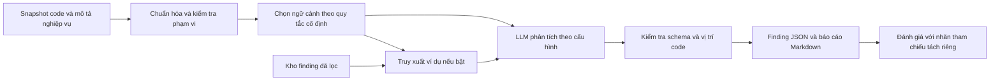

# Đề tài 1 — LLM hỗ trợ rà soát smart contract và lập báo cáo finding

> Phân tích ngày 23/10/2026. Đây là kế hoạch nghiên cứu, chưa phải kết quả thực nghiệm.
>
> Bối cảnh đã xác nhận: làm một mình, còn mới với Solidity/DeFi/Foundry, có thể làm toàn thời gian, ngân sách hạn chế. Giảng viên yêu cầu hiểu rõ và giải thích được bài toán.

**Đề xuất chọn hướng này cho 10 tuần**, với trọng tâm là phát hiện và giải thích một số lỗi có bằng chứng trong mã nguồn. Báo cáo là đầu ra; phần cần chứng minh là chất lượng finding và hiệu quả của phương pháp phân tích.

Ý tưởng ban đầu được giữ nguyên: LLM đọc code, giải thích rủi ro, đề xuất finding hoặc cách sửa, qua một lượt hoặc một quy trình có cấu trúc; chưa cần AI Agent.

Đọc [bản so sánh](so_sanh.md) để quyết định; xem [đề tài 2](De_tai_phu.md) để hiểu phần việc tăng thêm khi đưa Agent và Foundry vào vòng phản hồi.

**Demo giao diện:** mở [LLM Audit](demos/de_tai_1.html) bằng trình duyệt; xem [hướng dẫn hai demo](demos/README.md). Đây là prototype tương tác với dữ liệu mô phỏng, chưa gọi LLM hoặc thực thi công cụ audit.

## 1. Tên đề tài nên đăng ký

**Xây dựng và đánh giá hệ thống hỗ trợ rà soát smart contract Solidity bằng mô hình ngôn ngữ lớn với quy trình phân tích có cấu trúc.**

Trong đề cương, giới hạn vào một đến hai nhóm lỗi của hợp đồng DeFi đơn giản. Nếu phần truy xuất tri thức được chốt sau pilot, có thể bổ sung cụm “kết hợp tri thức từ báo cáo kiểm toán”. Không nên đưa khả năng tự sửa hoặc tự chứng minh exploit vào tên khi chưa coi đó là yêu cầu bắt buộc.

## 2. Hiểu chính xác bài toán

Một finding là một nhận định về lỗi, gồm vị trí, nguyên nhân, điều kiện xảy ra, tác động và khuyến nghị. Ví dụ: hàm nạp tiền tính sai số cổ phần của vault, khiến một người dùng nhận nhiều quyền rút tài sản hơn phần họ đóng góp.

Hệ thống nhận:

- Snapshot mã nguồn có phiên bản xác định, interface/dependency cần thiết và phạm vi file cần xem.
- Mô tả nghiệp vụ trung lập: ai được gọi hàm nào, tài sản đi đâu, quy tắc tính cổ phần hoặc phần thưởng. Tất cả cấu hình so sánh nhận cùng thông tin này.
- Tùy cấu hình: ví dụ lỗi tương tự từ kho báo cáo, đã loại tài liệu liên quan đến ca kiểm tra.

Hệ thống trả danh sách finding có cấu trúc, hoặc “chưa đủ bằng chứng để kết luận”:

| Trường | Nội dung cần có |
|---|---|
| `title`, `category` | Tên lỗi và nhóm lỗi trong phạm vi đã chọn |
| `location` | File, hàm, vùng dòng của đúng snapshot |
| `root_cause` | Cơ chế gây lỗi, gắn với code cụ thể |
| `preconditions` | Trạng thái, vai trò và điều kiện để lỗi xảy ra |
| `impact`, `severity_rationale` | Hậu quả và lý do đề xuất mức nghiêm trọng |
| `evidence` | Đường đi thực thi hoặc phép tính; phân biệt suy luận với kết quả đã chạy |
| `recommendation` | Hướng khắc phục; bản vá mã nguồn là phần mở rộng |
| `references`, `status` | Nguồn tham khảo và trạng thái kiểm tra |

**Ví dụ minh họa, không phải kết quả phát hiện:** một staking contract cộng thêm stake mới trước khi chốt phần thưởng cũ. Nếu công thức thưởng dùng số dư vừa tăng cho cả khoảng thời gian trước đó, người dùng có thể nhận thưởng cho thời gian chưa đóng góp. Finding đúng phải giải thích được thứ tự cập nhật, phép tính sai và điều kiện xảy ra; chỉ viết “reward có vấn đề” chưa đạt.

### Ba tác vụ phải phân biệt

| Tác vụ | Model được nhìn thấy gì? | Đo được điều gì? |
|---|---|---|
| Phát hiện lỗi | Code + mô tả chức năng, chưa biết finding của ca đó | Khả năng đề xuất lỗi từ mã nguồn |
| Giải thích finding đã biết | Code + finding được cung cấp | Khả năng diễn giải, không đo khả năng tự phát hiện |
| Đề xuất sửa lỗi đã biết | Code + lỗi đã xác nhận | Khả năng đề xuất khắc phục; muốn khẳng định bản vá đúng cần kiểm tra riêng |

**Tác vụ chính nên là hàng đầu tiên.** Hai tác vụ còn lại có thể demo phụ nhưng phải báo cáo riêng. Đưa báo cáo audit của chính hợp đồng vào prompt rồi yêu cầu “tìm lỗi” sẽ làm sai ý nghĩa thực nghiệm.

## 3. Giá trị học thuật và giới hạn của tính mới

Người rà soát phải đọc code, hiểu dòng tài sản và đối chiếu yêu cầu nghiệp vụ. LLM có thể hỗ trợ sinh giả thuyết và giải thích, nhưng cũng có thể bịa vị trí, hiểu sai điều kiện hoặc nhầm lỗi đã sửa. Đồ án cần đo được các giới hạn này.

Đóng góp phù hợp gồm bộ ca có nguồn gốc rõ ràng, quy trình tái lập, báo cáo có bằng chứng và thí nghiệm so sánh. **Không nhất thiết phải huấn luyện model mới**, nếu bộ môn không quy định thêm. Nếu chỉ gọi API rồi đổi định dạng câu trả lời, đóng góp sẽ yếu; phần dữ liệu và đánh giá là công việc nghiên cứu chính.

Ý tưởng LLM kết hợp tri thức hoặc phân tích chương trình đã có tiền lệ. [LLM4Vuln](https://arxiv.org/abs/2401.16185) tách ảnh hưởng của tri thức, ngữ cảnh và prompting; [GPTScan](https://arxiv.org/abs/2308.03314) kết hợp LLM với phân tích tĩnh để tìm lỗi logic. Nên trình bày đây là xây dựng và đánh giá giải pháp trong phạm vi xác định, không tuyên bố phương pháp đầu tiên hay vượt công cụ thương mại.

## 4. Phạm vi phù hợp trong 10 tuần

### Bắt buộc

1. Phân tích được hợp đồng nhỏ cùng mô tả nghiệp vụ.
2. Baseline gọi LLM trực tiếp và phương pháp phân tích có cấu trúc.
3. Finding xuất JSON và Markdown bằng template cố định.
4. Bộ ca có nhãn tham chiếu, chia development/test trước khi chỉnh prompt.
5. Đo phát hiện đúng, báo sai, chất lượng giải thích, thời gian và chi phí.

**Phạm vi code:** mỗi ca ưu tiên 1–3 file nghiệp vụ chính, khoảng 200–800 dòng cần đọc. Dependency vẫn phải sẵn sàng và được tính nếu đưa vào prompt. Đây là giới hạn thiết kế dự kiến, cần chỉnh theo pilot; không nhận mọi repository rồi hứa audit toàn bộ.

**Nhóm lỗi:** bắt đầu với sai lệch kế toán tài sản/cổ phần ở vault đơn giản. Chỉ thêm lỗi cập nhật phần thưởng staking khi đã có đủ ca và hiểu mô hình. Không đưa oracle đa giao thức, liquidation phức tạp, MEV, cross-chain hoặc kinh tế học AMM vào MVP.

### Mở rộng có điều kiện

- Truy xuất ví dụ tương tự từ báo cáo audit: ưu tiên từ khóa/BM25 trước; embedding là bước tiếp theo.
- Slither cung cấp thông tin hàm, biến hoặc cảnh báo như cấu hình bổ sung.
- Kiểm tra thủ công bằng Foundry cho một số finding tiêu biểu.
- Giao diện đơn giản để chọn ca và xem báo cáo.

**Không cam kết:** fine-tuning, multi-agent, sinh exploit cho mọi finding, tự sửa repository, tìm zero-day, giao diện lớn hay triển khai mainnet.

## 5. Dữ liệu đang có: lợi thế và công việc còn thiếu

Kiểm kê file Markdown trong [thư mục dữ liệu](md_rag_output_last_3000/) ngày 23/10/2026:

| Dấu hiệu được đếm | Số lượng | Cách hiểu |
|---|---:|---|
| File `.md` | 3.000 | Finding xuất ra file, không đồng nghĩa 3.000 contract độc lập |
| `severity: LOW` | 1.816 | Dữ liệu nghiêng về mức LOW |
| `severity: MEDIUM` | 688 | Có thể lọc làm nguồn ứng viên |
| `severity: HIGH` | 460 | Mức nghiêm trọng theo nguồn, cần đọc bối cảnh |
| `severity: GAS` | 36 | Không trộn với lỗ hổng bảo mật trong chỉ số chính |
| Giá trị `protocol` khác nhau | 216 | Chuỗi metadata, chưa chuẩn hóa tên dự án |
| Giá trị `firm` khác nhau | 14 | Chuỗi metadata |
| `categories: []` | 2.994 | Gần như chưa có nhãn nhóm lỗi dùng được ngay |
| Có khối mở bằng ba backtick + `solidity` | 775 | Dấu hiệu có code, không bảo đảm đủ mã để build |
| Có liên kết `https://github.com/` | 1.701 | Không bảo đảm liên kết trỏ đúng commit có lỗi |
| Có dấu hiệu `**Source:**` | 2.896 | 104 file còn lại thiếu đúng dấu hiệu này, chưa thể nói chúng không có nguồn |

Đây là thống kê cú pháp, **chưa phải thẩm định nội dung**. Tên `last_3000` không chứng minh dữ liệu mới nhất. File `solodit-json-full.zip` có sẵn nhưng chưa được mở để kiểm chứng tính đầy đủ hoặc cấu trúc trong phân tích này.

[Solodit](https://docs.solodit.cyfrin.io/) tổng hợp finding từ nhiều bên; không phải công ty audit tương đương Spearbit. Có thể học cách trình bày từ báo cáo gốc, nhưng không có một “chuẩn report Solodit” duy nhất cần bắt chước.

### Hai tập có vai trò khác nhau

**Kho tri thức truy xuất:** báo cáo đã làm sạch, gợi nhắc mẫu nguyên nhân và điều kiện. Bắt đầu từ khoảng 100–300 finding liên quan sau lọc; không cần gán nhãn thủ công toàn bộ 3.000 bản ghi. Giữ nguồn, protocol và nội dung cần thiết; đọc kiểm tra một mẫu trước khi sử dụng.

**Bộ đánh giá:** code đúng phiên bản có lỗi, bản đã sửa hoặc đối chứng, mô tả nghiệp vụ, finding tham chiếu và lý do chấm đúng/sai. Tập báo cáo hiện có chưa cung cấp chắc chắn các thành phần này. Việc quan trọng nhất là nối finding về snapshot mã nguồn thích hợp.

Mục tiêu dự kiến là **16 ca gốc**, khoảng 10 ca từ dự án/báo cáo công khai và 6 ca tối giản có kiểm soát. Mỗi ca có bản lỗi và bản đối chứng đã sửa lỗi mục tiêu: tổng 32 đầu vào. Chia theo nhóm dự án thành khoảng 4 ca gốc development và 12 ca gốc test. Nếu số ca mỗi dự án khiến tỷ lệ này không thể giữ nguyên, ưu tiên tách dự án và ghi số thực tế.

Mức tối thiểu sau thu gọn là 12 ca gốc, ưu tiên ít nhất 8 ca có nguồn thực tế. **Đây là mục tiêu thu thập, chưa phải dữ liệu đã xác nhận.** Ca tự xây và ca rút gọn phải đánh dấu riêng; ca rút gọn không tương đương đánh giá toàn dự án thật. Nếu thiếu dữ liệu, thu về một nhóm lỗi và sửa câu hỏi nghiên cứu, không bù bằng các bản sao gần giống.

Nguồn khảo sát: [dataset GPTScan](https://github.com/GPTScan/GPTScan), báo cáo gốc liên kết từ dữ liệu địa phương và kho code có lịch sử sửa lỗi. [SmartBugs Curated](https://github.com/smartbugs/smartbugs-curated) có hợp đồng gán nhãn, nhưng taxonomy thiên về lỗi Solidity truyền thống; chỉ chọn ca phù hợp, không dùng thay tự động cho bộ lỗi nghiệp vụ DeFi.

### Ngăn lộ đáp án

- Chia theo dự án/protocol và nhóm code gần trùng, không chia ngẫu nhiên từng finding.
- Bản lỗi/đã sửa của cùng ca luôn ở cùng tập; không cho model biết chúng là một cặp khi chạy.
- Loại khỏi kho truy xuất báo cáo của project kiểm tra, phiên bản/fork liên quan và bài viết sao chép cùng sự cố; rà trùng nội dung và code, không chỉ tên.
- Loại test exploit có sẵn, patch diff, comment chỉ rõ lỗi và tên file tiết lộ nhãn khỏi đầu vào. Giữ mô tả chức năng trung lập.
- Không dùng nhãn chuẩn tạo truy vấn tìm kiếm trong lượt chạy chính.
- Ghi nhận model có thể đã biết dữ liệu công khai từ huấn luyện. Tách dữ liệu giảm rò rỉ do mình tạo ra, không chứng minh xóa được ghi nhớ của model.

## 6. Kiến trúc dễ hiểu và dễ bảo vệ



Phiên bản đầu chỉ cần Python, JSON/Markdown, một API model và module truy xuất nhỏ; chưa bắt buộc dịch vụ vector database. Chọn model sau pilot rồi giữ nguyên ID/cấu hình trong thí nghiệm chính; chưa cần so sánh nhiều nhà cung cấp.

Hướng dẫn phân tích yêu cầu xác định vai trò, dòng tài sản, trạng thái, thuộc tính cần giữ, tình huống biên và bằng chứng cho finding. Đầu ra cần giải thích kiểm tra được, không yêu cầu hay chấm suy nghĩ nội bộ của model.

Ban đầu A0 và A1 đều dùng **một lần gọi LLM cho mỗi đầu vào**, khác hướng dẫn phân tích. Chọn ngữ cảnh, truy xuất, kiểm tra JSON và xuất báo cáo là code điều khiển cố định. Nếu thêm nhiều lượt sinh/phản biện, đánh giá riêng cùng ngân sách tăng thêm.

Đây là workflow có cấu trúc: chương trình định trước bước đi. Agent ở đề tài 2 có thêm quyền chọn hành động/công cụ theo phản hồi. Workflow vẫn có thể chạy Slither hoặc Foundry theo lịch cố định mà chưa cần đổi tên thành Agent.

## 7. Thiết kế thực nghiệm

### Câu hỏi nghiên cứu và cấu hình

| Câu hỏi | So sánh chính | Điều giữ cố định |
|---|---|---|
| Phân tích có cấu trúc giúp gì? | A0: prompt trực tiếp; A1: prompt có checklist và schema | Model, code, mô tả, schema đầu ra, giới hạn finding và ngân sách sinh |
| Ví dụ truy xuất giúp gì thêm? | A1; A2: A1 + tối đa 3 finding tham khảo | Model, prompt phân tích, test set, cách chấm |
| Hỗ trợ này tốn bao nhiêu? | Chất lượng so với token, thời gian, tiền thực | Ghi cả truy xuất, lần gọi lỗi và retry |

A0 vẫn trả cùng schema để tránh chấm lợi thế định dạng. A2 có thêm ngữ cảnh nên phải báo token tăng; không quy toàn bộ hiệu quả cho riêng thuật toán truy xuất. Có thể thêm thử nghiệm ví dụ ngẫu nhiên cùng độ dài nếu còn thời gian.

Nếu dùng [Slither](https://github.com/crytic/slither), chạy như baseline công cụ hoặc cấu hình bổ sung và tách kết quả theo nhóm lỗi. Phạm vi detector không trùng toàn bộ bài toán nghiệp vụ; Slither không báo một lỗi không tự chứng minh phương pháp mới tốt hơn mọi mặt.

### Chấm finding

Finding đúng phải khớp **nguyên nhân gốc + vị trí/cơ chế + điều kiện khả thi + tác động**. Không chấm bằng trùng tiêu đề hoặc từ khóa. Severity chấm riêng vì phụ thuộc ngữ cảnh.

- Gộp finding trùng nguyên nhân trước khi tính; ghép một-một với lỗi tham chiếu.
- `TP`: finding hợp lệ khớp lỗi tham chiếu. `FP`: nhận định đã kiểm tra và bác bỏ. `FN`: lỗi tham chiếu không được tìm thấy.
- `Precision = TP / (TP + FP)`; `Recall_tham_chiếu = TP / (TP + FN)`. Recall chỉ áp dụng danh sách lỗi có nhãn, không phải mọi lỗi tồn tại trong contract.
- Nhận định chưa xác minh mang nhãn `unresolved`; công bố số lượng. Báo thêm precision bảo thủ tính toàn bộ unresolved là sai, tránh lặng lẽ bỏ chúng để tăng điểm.
- Finding ngoài nhãn nhưng được xác nhận hợp lệ ghi là `new_confirmed`, báo riêng; không tự động coi là FP. Khi đó `Precision_tổng = (TP + new_confirmed) / (TP + new_confirmed + FP)`; bản bảo thủ cộng thêm unresolved vào mẫu số. Chỉ mở rộng nhãn tham chiếu sau quy trình kiểm tra nhất quán cho mọi cấu hình, đồng thời giữ kết quả recall trên bộ nhãn ban đầu. Mẫu số bằng 0 ghi `N/A`.
- Bản đã sửa là đối chứng cho lỗi mục tiêu; nếu model báo lỗi khác phải xét riêng, không mặc định contract tuyệt đối an toàn.
- Đo tỷ lệ báo lại lỗi đã sửa, vị trí code hợp lệ và kết luận thiếu điều kiện cần.

Giải thích chấm mỗi tiêu chí 0–2: đúng nguyên nhân, điều kiện, tác động, bằng chứng gắn code, khuyến nghị xử lý nguyên nhân. Công bố rubric và ví dụ. Nhờ giảng viên/người biết Solidity kiểm tra chéo khoảng 20–30% kết quả nếu có thể; nếu chỉ một người chấm, ghi rõ hạn chế. Không dùng chính LLM sinh finding làm người chấm duy nhất.

Chạy mỗi cấu hình khoảng 3 lần, giữ cấu hình đã khóa; ghi từng lần, trung bình và độ dao động. Với mục tiêu 24 đầu vào test: `24 × 3 cấu hình × 3 lần = 216 lượt phân tích`. Đây là cuộc gọi chính khi mỗi lượt có một cuộc gọi; development và retry cộng riêng.

Hai phiên bản của một ca có liên quan; khi tóm tắt độ bất định, lấy ca gốc/project làm đơn vị nhóm. Mẫu nhỏ phù hợp nghiên cứu thăm dò và phân tích lỗi, chưa đủ khẳng định tổng quát cho mọi DeFi.

**A2 không hơn A1 vẫn có giá trị** nếu phép đo đáng tin: phân tích truy xuất nhầm, ngữ cảnh nhiễu, thiếu code hay model đã có kiến thức. Không đổi test set hoặc chỉ chọn ca đẹp để tạo kết luận tích cực.

## 8. Lịch 10 tuần và mốc thu hẹp

Giả định tổ chức khoảng 35 giờ có kế hoạch mỗi tuần, tổng khoảng 350 giờ. Đây là cách chia việc đề xuất từ khả năng làm toàn thời gian, không phải số giờ bạn đã cam kết. Dự kiến 60 giờ học nền tảng, 60 giờ dữ liệu, 65 giờ hệ thống, 65 giờ thực nghiệm, 65 giờ báo cáo/demo và 35 giờ dự phòng; các phần đan xen.

| Tuần | Trọng tâm | Đầu ra kiểm tra được |
|---|---|---|
| 1 | Solidity, tài sản/cổ phần, báo cáo, Foundry cơ bản | Giải thích 2 lỗi nhỏ bằng tay; chạy unit test; mô tả bài toán 1 trang |
| 2 | Khảo sát code thật, chốt một nhóm lỗi trước | ≥6 ca gốc dùng được, ưu tiên ≥3 ca nguồn thực tế; đủ code, mô tả, nhãn |
| 3 | Chuẩn hóa, chia tập, làm A0 | Manifest có nguồn/commit/hash; đầu vào → JSON → Markdown |
| 4 | Hoàn thiện A1, rubric và dữ liệu | Chốt bộ ca tối thiểu; thử development, không chỉnh theo test |
| 5 | Truy xuất đơn giản và A2 | Nguồn truy vết được, lọc project kiểm tra, đo token/cost |
| 6 | Kiểm tra hệ thống và cách chấm | Khóa model, prompt, dữ liệu, giới hạn; chạy thử quy trình |
| 7 | Thí nghiệm chính | Kết quả từng ca/từng lần, log và chi phí |
| 8 | Kiểm tra finding, phân tích lỗi, test một số ca | Bảng kết quả, ví dụ TP/FP/FN và giới hạn |
| 9 | Luận văn và demo | Bản thảo đầy đủ, kiến trúc, demo một ca đúng và một ca báo sai |
| 10 | Dự phòng, sửa báo cáo, luyện bảo vệ | Gói tái lập, slide, video/log demo dự phòng |

**Mốc quyết định:** cuối tuần 2 thiếu 6 ca thì bỏ nhóm lỗi thứ hai, giảm kích thước code. Cuối tuần 4 thiếu bộ đánh giá tối thiểu thì ưu tiên dữ liệu, bỏ giao diện và bản vá tự động. Cuối tuần 5 truy xuất vẫn nhiễu thì giữ A0/A1 làm câu hỏi chính, chuyển RAG thành thử nghiệm phụ và cập nhật đề cương với giảng viên. Cuối tuần 6 khóa tính năng, không bắt đầu làm Agent.

## 9. Chi phí và cách kiểm soát

Chi phí nằm ở token lặp lại, thử prompt và công đọc/chấm dữ liệu. Hướng API không cần mua GPU; model local chỉ hợp lý khi máy sẵn có đáp ứng và đã đo chất lượng/độ trễ.

```text
Chi phí LLM = tổng token_input / 1.000.000 × đơn giá_input
            + tổng token_output / 1.000.000 × đơn giá_output
Tổng dự án  = chi phí LLM + truy xuất/embedding (nếu có) + hạ tầng khác
```

Ví dụ **chỉ để lập ngân sách, không phải bảng giá model nào**: 216 lượt, trung bình 8.000 token input và 1.500 token output/lượt, giá giả định 1 USD/triệu input và 5 USD/triệu output, cho khoảng 3,35 USD ở lượt chạy chính (1.728.000 input token và 324.000 output token). Giá thực tế, token suy luận tính phí, context dài và retry có thể làm khác đáng kể. Đo pilot rồi tính thêm development, lần chạy lỗi và dự phòng; không lấy ví dụ này làm cam kết tổng tiền.

Chốt trần tiền theo ngân sách thực có trước batch; log từng lượt, giới hạn token và tối đa một retry lỗi định dạng/vận chuyển. Cache dữ liệu được, không dùng cache câu trả lời để giả làm ba lần chạy độc lập. Nếu thiếu tiền, giảm cấu hình/phạm vi và công bố điều chỉnh, giữ test set nhất quán.

## 10. Câu phải trả lời được khi bảo vệ

| Câu hỏi | Câu trả lời cần nắm |
|---|---|
| Vì sao cần mô tả nghiệp vụ ngoài code? | Code cho biết cách thực thi; kết luận sai nghiệp vụ cần quy tắc mong muốn |
| Làm sao biết finding đúng? | Khớp cơ chế, điều kiện, tác động với nhãn có nguồn; đối chiếu code/tính toán/test |
| Khác gì gọi chatbot đọc code? | Phạm vi cố định, dữ liệu tách tập, baseline, đầu ra kiểm tra được và đánh giá tái lập |
| Vì sao dùng kho báo cáo? | Gợi nhắc mẫu lỗi; không lấy báo cáo của ca test làm đáp án |
| Có thay auditor không? | Chưa có cơ sở; chỉ hỗ trợ sinh và rà soát giả thuyết trong phạm vi hẹp |
| Nếu không hơn baseline? | Trình bày kết quả thật, phân tích nguyên nhân; thiết kế thí nghiệm vẫn là đóng góp |
| Bản sửa đã chắc đúng chưa? | Chỉ là khuyến nghị nếu chưa kiểm tra riêng lỗi mục tiêu và hành vi hợp lệ |

## 11. Sản phẩm bàn giao dự kiến

- Pipeline và cấu hình A0/A1; A2 nếu đạt mốc triển khai.
- Manifest bộ ca, nhãn tách khỏi đầu vào, nguồn/commit và cách lấy lại theo điều kiện sử dụng của nguồn gốc.
- Kho tri thức đã lọc hoặc script dựng lại, quy tắc loại trùng và project kiểm tra.
- Markdown/JSON/CSV, log model/token/thời gian và hướng dẫn tái lập.
- Luận văn và demo thể hiện cả phần làm được lẫn giới hạn.

Đây là kế hoạch bàn giao, chưa phải các thành phần đã tồn tại trong repository.

## 12. Tài liệu gốc nên đọc

- [LLM4Vuln v4](https://arxiv.org/abs/2401.16185v4): tách các yếu tố ảnh hưởng kết quả.
- [GPTScan, ICSE 2024](https://arxiv.org/abs/2308.03314): LLM kết hợp phân tích chương trình.
- [Giới thiệu Solodit](https://docs.solodit.cyfrin.io/): vai trò kho finding và báo cáo gốc.
- [Slither chính thức](https://github.com/crytic/slither): detector và phạm vi công cụ.
- [EIP-4626](https://eips.ethereum.org/EIPS/eip-4626): quy tắc vault nếu chọn ca theo chuẩn; không suy diễn mọi vault tuân chuẩn.

Nhận định độ phù hợp trong 10 tuần là đánh giá lập kế hoạch theo bối cảnh của bạn. Phân tích dùng file trong workspace, thông tin bạn cung cấp và tài liệu gốc; chưa có nội dung các đoạn chat khác để tổng hợp hoặc kiểm chứng.
