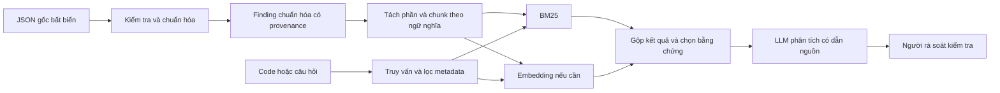

# Đánh giá bộ dữ liệu finding và khả năng sử dụng với LLM

> Ngày đánh giá: **23/10/2026**. Phạm vi: toàn bộ 3.000 JSON trong `rag_output_last_3000/` và 3.000 Markdown tương ứng trong `md_rag_output_last_3000/`.
>
> Bối cảnh sử dụng: đồ án 10 tuần, một người, ngân sách hạn chế; ưu tiên LLM hỗ trợ rà soát một số lỗi Solidity/DeFi. Những đánh giá “phù hợp/chưa phù hợp” dưới đây gắn với tác vụ cụ thể, không phải điểm chất lượng tuyệt đối của bộ dữ liệu.

**Bộ dữ liệu dùng được làm nguồn xây kho tri thức cho LLM, sau bước làm sạch và chọn phạm vi.** Điểm mạnh là nội dung finding thực tế, có nguồn, tên dự án, severity và nhiều ví dụ code. Điểm yếu chính là nhãn loại lỗi gần như thiếu, nội dung không đồng nhất về miền/ngôn ngữ, một số lỗi trình bày và thông tin sửa lỗi trộn với mô tả lỗi ban đầu.

**Chưa nên dùng nguyên trạng làm bộ huấn luyện phát hiện lỗi, benchmark audit hoặc bộ ca exploit tự chạy.** Hiện đây chủ yếu là *báo cáo về lỗi*, chưa phải tập cặp *mã nguồn đầy đủ — nhãn lỗi — bản sửa — test oracle* được xác minh.

**Nên dùng JSON làm bản chuẩn để xử lý; Markdown dùng để đọc và trình bày.** Chuyển sang Markdown không tự tăng chất lượng tri thức, và không bắt buộc phải chuyển sang Markdown mới làm được RAG.

## 1. Phân tích này đã làm gì?

| Mức kiểm tra | Công việc thực hiện | Có thể kết luận |
|---|---|---|
| Đo trên toàn tập | Parse, ID, schema/trường, độ dài, ngày, nguồn, tag, code fence, ảnh, ký tự, trùng nội dung | Chất lượng kỹ thuật và dấu hiệu cần rà soát |
| Đối chiếu hai định dạng | Ghép theo tên file/ID, kiểm tra body `content`, một số metadata và xuống dòng | Mức bảo toàn nội dung khi chuyển đổi |
| Đọc định tính | Mẫu chủ đích từ nhiều nguồn, ca ngắn/dài, tag đáng ngờ, code ngoài Solidity, ví dụ lỗi | Minh họa các dạng chất lượng và rủi ro; không ước lượng tỷ lệ finding đúng |
| Thử truy xuất cục bộ | BM25 trên `title + content`, sáu truy vấn Anh và sáu truy vấn Việt về finding đã đọc | Kiểm tra khả năng tìm kiếm từ khóa ở một số ca đã biết |
| Chưa thực hiện | Chạy LLM/embedding, kiểm tra code/PoC bằng compiler/Foundry, kiểm tra toàn bộ URL, xác minh mọi finding | Chưa có số liệu chất lượng sinh câu trả lời hoặc độ đúng bảo mật trên toàn tập |

Hai script được giữ lại để bạn chạy lại, không sửa dữ liệu đầu vào:

```powershell
node tools/analyze_dataset.mjs --as-of 2026-10-23
node tools/probe_dataset_retrieval.mjs
```

Các file bằng chứng:

- [Script kiểm kê và đối chiếu](tools/analyze_dataset.mjs).
- [Thống kê tổng hợp](analysis/dataset_quality_summary.json).
- [Kết quả từng bản ghi](analysis/dataset_quality_records.jsonl): ID, nguồn, độ dài và các cờ kiểm tra.
- [43 ứng viên cần đọc kiểm tra](analysis/dataset_review_candidates.json): danh sách chọn có chủ đích, **không có nghĩa cả 43 đã được xác minh**.
- [Script thử BM25](tools/probe_dataset_retrieval.mjs) và [kết quả sáu cặp truy vấn](analysis/retrieval_smoke_test.json).

Trong báo cáo này, **số đếm** là kết quả script; **dấu hiệu** là phép kiểm tra regex/cấu trúc; **nhận xét ngữ nghĩa** dựa trên mẫu đã đọc; **quy trình đề xuất** là phần chưa triển khai. Không đổi dấu hiệu tự động thành kết luận chuyên gia.

## 2. Phù hợp với tác vụ LLM nào?

| Cách dùng | Đánh giá hiện tại | Điều kiện cần thêm |
|---|---|---|
| Đọc và học các mẫu lỗi | Phù hợp | Đọc nguyên nhân cùng điều kiện, tác động và phản hồi sửa lỗi |
| Tìm finding tương tự | Phù hợp để bắt đầu | Làm sạch, giữ nguồn, xử lý truy vấn và kiểm tra relevance |
| RAG hỏi đáp về finding | Phù hợp có điều kiện | Chunk hợp lý, dẫn nguồn, biết từ chối khi thiếu bằng chứng |
| Hỗ trợ LLM suy nghĩ khi đọc code mới | Có tiềm năng, chưa được chứng minh bằng thí nghiệm này | Truy xuất mẫu tương tự, đối chiếu điều kiện với code đích, chống lộ đáp án |
| Sinh bản nháp báo cáo | Có thể làm sau chuẩn hóa | Schema finding, phân biệt dữ kiện nguồn với suy luận mới |
| Tạo dữ liệu hướng dẫn giải thích/tóm tắt | Có thể dùng làm nguyên liệu | Tạo cặp tác vụ, kiểm tra đầu ra, tách theo nhóm nguồn |
| Fine-tune để tự phát hiện lỗi từ code | Chưa sẵn sàng | Code/ngữ cảnh đủ, nhãn xác minh, ca đối chứng và chống rò rỉ |
| Huấn luyện từ đầu một LLM | Không phù hợp với mục tiêu và quy mô này | Không phải hướng hợp lý cho đồ án hiện tại |
| Benchmark precision/recall của công cụ audit | Chưa sẵn sàng | Bộ code có lỗi/đã sửa, nhãn tham chiếu và cách chấm độc lập |
| Tự sinh và xác nhận exploit | Chưa sẵn sàng | Dependency, compiler, state, harness, actor, test oracle và replay |

RAG là đưa tài liệu truy xuất được vào ngữ cảnh lúc trả lời; không đồng nghĩa model đã học lại trọng số. Bài báo [Retrieval-Augmented Generation](https://arxiv.org/abs/2005.11401) là tiền lệ của cách kết hợp model với bộ nhớ tài liệu truy xuất. Việc cách tiếp cận này có ích trong nghiên cứu khác chưa chứng minh nó tăng độ chính xác audit trên bộ dữ liệu của bạn.

## 3. Kiểm kê cấu trúc: nền tảng kỹ thuật tốt

| Chỉ số | Kết quả | Ý nghĩa |
|---|---:|---|
| JSON được đọc/parse thành công | 3.000/3.000 | Không phát hiện lỗi cú pháp JSON hoặc UTF-8 ở bước đọc |
| Markdown ghép được với JSON | 3.000/3.000 | Không thiếu cặp theo tên file |
| ID duy nhất | 3.000 | Không trùng ID |
| ID khớp tên `finding_<id>.json` | 3.000/3.000 | Có thể dùng ID làm khóa liên kết |
| Khoảng ID | 59.806–62.955 | Không phải dải liên tiếp; khoảng trống chưa chứng minh dữ liệu bị mất |
| `title`, `content`, `impact`, ngày, firm, protocol có giá trị | 3.000/3.000 | Có phần lõi để lập chỉ mục |
| Tên firm/protocol khớp trường nested tương ứng | 3.000/3.000 | Không thấy mâu thuẫn ở hai cặp trường này |
| `kind` | 3.000 `MARKDOWN` | **Content trong JSON vốn đã là Markdown**, JSON chỉ là lớp bao chứa metadata |
| Tên nguồn khác nhau ở trường `firm_name` | 14 | Gồm cả đơn vị audit và nền tảng cuộc thi/bug bounty |
| Protocol theo tên / ID | 216 / 216 | Chưa đồng nghĩa 216 nhóm dự án hoàn toàn độc lập |
| Dung lượng JSON | 12.946.494 byte | Khoảng 12,95 MB theo hệ thập phân |
| Dung lượng Markdown | 9.474.715 byte | Khoảng 9,47 MB; nhỏ hơn không có nghĩa chất lượng tốt hơn |

Schema khá nhất quán ở phần lõi. Một số trường tùy chọn không đồng nhất: `issues_issue_finders` hiện diện ở 2.968 bản ghi; `sponsor_name` có cả `null` và chuỗi. Khi nạp dữ liệu nên phân biệt **không có trường, null, chuỗi rỗng, mảng rỗng và số 0**, thay vì dùng một phép kiểm tra truthy cho mọi trường.

Ví dụ, `quality_score = 0` vẫn là một giá trị có trong dữ liệu; `categories = []` thể hiện chưa có tag nguồn, không chứng minh finding không thuộc loại lỗi nào.

## 4. Bản Markdown có giữ được dữ liệu không?

### 4.1. Body finding được giữ tốt

- 2.995/3.000 body khớp `content` sau chuẩn hóa CRLF/CR thông thường và khoảng trắng đầu/cuối.
- Năm file `62187`, `62188`, `62189`, `62190`, `62191` có chuỗi xuống dòng `CR CR LF` ở bản Markdown. Khác biệt này phù hợp hiện tượng chuyển newline hai lần.
- Khi chuẩn hóa cả `CR CR LF` thành một newline, **3.000/3.000 body khớp**.
- Không phát hiện mất văn bản trong body theo phép đối chiếu này. Đây không phải chứng nhận nội dung gốc không thiếu đoạn từ PDF/website.

Một lưu ý kỹ thuật khi tự kiểm tra: nội dung một số finding đã chứa tiêu đề `## Vulnerability Details`. Chỉ được bỏ tiêu đề wrapper đầu tiên của bản chuyển đổi; tách tất cả các lần xuất hiện có thể tự làm biến dạng nội dung trong chương trình kiểm tra.

### 4.2. Frontmatter cần sửa cách serialize

Có **74 file** mà trường `protocol` hoặc `firm` dạng scalar không có dấu nháy chứa `: `, ví dụ:

```yaml
protocol: Doomsday: Settlers of the Wasteland
```

Đây là dấu hiệu không an toàn cho parser YAML thông thường; tên protocol cần được quote/serialize đúng. Các tên liên quan gồm Doomsday, Shardeum và Uniswap: The Compact. Quy tắc scalar và escape được mô tả trong [YAML 1.2.2](https://yaml.org/spec/1.2.2/).

Có **năm tiêu đề** không round-trip theo cách đọc chuỗi double-quoted kiểu JSON mà script kiểm tra sử dụng: ID `61021`, `61130`, `61133`, `61134`, `61143`. Chúng có dấu backslash trong tên như `sync\_trie\_hashes`. Script chuyển đổi hiện có chỉ escape dấu nháy kép, chưa serialize đầy đủ backslash. **Không gọi đây là “năm lỗi parse YAML đã đo”**: lần kiểm tra này chưa chạy một parser YAML đầy đủ; escape của YAML cũng không hoàn toàn giống JSON.

Cách sửa nên dùng serializer chuẩn. Nếu chỉ cần frontmatter đơn giản, có thể serialize các giá trị scalar và mảng bằng cú pháp JSON hợp lệ thay vì ghép tên trực tiếp:

```javascript
const lines = [
  '---',
  `id: ${record.id}`,
  `title: ${JSON.stringify(record.title)}`,
  `severity: ${JSON.stringify(record.impact)}`,
  `protocol: ${JSON.stringify(record.protocol_name)}`,
  `date: ${JSON.stringify(record.report_date.slice(0, 10))}`,
  `firm: ${JSON.stringify(record.firm_name)}`,
  `categories: ${JSON.stringify(sourceTags)}`,
  '---'
];
```

Đây là gợi ý sửa bộ chuyển đổi, chưa áp dụng lên 3.000 file gốc. Nên thêm kiểm tra round-trip bằng parser được chọn trước khi dùng frontmatter làm bộ lọc.

### 4.3. Markdown là bản trình bày có lược bớt metadata

Các trường như ID trong body metadata, protocol ID, auditfirm ID, `github_link`, `pdf_link`, trang PDF, điểm cộng đồng và thông tin người tìm không được giữ nguyên cấu trúc JSON trong frontmatter hiện tại. Một số vẫn xuất hiện trong văn bản, nhưng không thay thế được trường dữ liệu có kiểu rõ ràng.

**Khuyến nghị:** JSON là bản chuẩn; kho chuẩn hóa cũng nên là JSONL hoặc bảng dữ liệu. Markdown được dựng lại từ đó để con người đọc. Không nạp cả bản JSON và Markdown của cùng finding như hai tài liệu độc lập vì sẽ nhân đôi tri thức trong chỉ mục.

## 5. Những metadata nào dùng được, metadata nào chưa đáng tin?

| Trường/dấu hiệu | Bản ghi | Tỷ lệ | Cách dùng phù hợp |
|---|---:|---:|---|
| `summary` không rỗng | 1.138 | 37,93% | Có thể hỗ trợ hiển thị; cần xem nguồn gốc và mức trùng body |
| `source_link` là URL HTTP(S) hợp lệ về cú pháp | 2.896 | 96,53% | Là ứng viên nguồn, chưa kiểm tra khả năng truy cập |
| `github_link` có URL | 309 | 10,30% | Không mặc định là repository hoặc commit có lỗi |
| `pdf_link` có URL | 270 | 9,00% | Cần giữ cả trang PDF khi có |
| Có tag trong `issues_issuetagscore` | 6 | 0,20% | Quá ít để làm taxonomy tin cậy |
| Có category protocol trong trường nested | 104 | 3,47% | Là category của protocol, không tự động là loại lỗ hổng |
| `quality_score = 0` | 2.958 | 98,60% | Chưa rõ semantics số 0 ở bản xuất; không coi là finding kém |
| `general_score = 0` | 2.966 | 98,87% | Không dùng như chất lượng được kiểm chứng |

[Solodit](https://docs.solodit.cyfrin.io/) là nền tảng tổng hợp finding và có đánh giá/tag cộng đồng. Điều này không biến điểm số nguồn thành nhãn chuẩn cho đồ án. Lọc `quality_score > 0` chỉ giữ 42 bản ghi, có nguy cơ bỏ gần hết dữ liệu hữu ích chỉ vì thiếu đánh giá.

### Ngay cả sáu bản ghi có tag cũng cần đọc lại

- [61599](rag_output_last_3000/finding_61599.json): thiếu kiểm tra độ mới của giá; tag `Oracle` phù hợp với nội dung đã đọc.
- [61521](rag_output_last_3000/finding_61521.json): hoàn trả collateral sai khi liquidation, nhưng tag nguồn là `ABI Encoding`; nội dung đã đọc chưa cho thấy tag này mô tả đúng nguyên nhân chính.
- [62469](rag_output_last_3000/finding_62469.json): logic ETH không cần thiết trong resolver, nhưng có các tag như `51% Attack`, `1/64 Rule`; chưa thấy căn cứ cho các tag đó trong finding.
- [61888](rag_output_last_3000/finding_61888.json): code `.fc` và khoản phí/hoàn tiền TON, nhưng có tag `Arbitrum` cùng các tag khác chưa được giải thích bởi nội dung.

Đây là **nghi vấn chất lượng nhãn từ việc đọc nội dung**, chưa xác định được nguyên nhân là thao tác gán tag, dữ liệu xuất hay lỗi upstream. Không nên lấy sáu nhãn này làm chuẩn rồi suy rộng ra 2.994 bản ghi còn lại.

Ngoài ra, `impact` trong JSON đang được dùng như severity tổng hợp. Trong [61521](rag_output_last_3000/finding_61521.json), JSON là MEDIUM còn phần mô tả ghi Impact High, Likelihood Low. Điều này có thể là ma trận đánh giá hợp lệ, không tự động là nhãn mâu thuẫn. Nên tách `source_severity`, `source_impact`, `source_likelihood` khi trích xuất.

## 6. Độ phủ và thiên lệch: chưa đại diện cho mọi smart contract

### 6.1. Theo mức độ nghiêm trọng

| Nhãn nguồn | Số lượng | Tỷ lệ |
|---|---:|---:|
| LOW | 1.816 | 60,53% |
| MEDIUM | 688 | 22,93% |
| HIGH | 460 | 15,33% |
| GAS | 36 | 1,20% |

Không nên coi toàn bộ LOW là rác hoặc không phải lỗi logic. Hai finding [61058](rag_output_last_3000/finding_61058.json) và [61069](rag_output_last_3000/finding_61069.json) đều LOW nhưng mô tả làm tròn khi rút tài sản, sát phạm vi vault dự kiến của đồ án. Ngược lại, một số LOW chỉ liên quan readability hoặc code style.

GAS nên tách khỏi chỉ mục chuyên lỗ hổng nếu tác vụ không quan tâm tối ưu gas. Sau bước lọc đơn giản đó còn 2.964 bản ghi, **chưa phải 2.964 lỗi bảo mật đã xác minh**.

### 6.2. Theo nguồn

| `firm_name` | Số lượng | Tỷ lệ |
|---|---:|---:|
| Quantstamp | 1.372 | 45,73% |
| Pashov Audit Group | 323 | 10,77% |
| Cyfrin | 285 | 9,50% |
| Spearbit | 213 | 7,10% |
| Immunefi | 146 | 4,87% |
| MixBytes | 127 | 4,23% |
| Sherlock | 104 | 3,47% |
| Hexens | 93 | 3,10% |
| Shieldify | 93 | 3,10% |
| Code4rena | 89 | 2,97% |
| OpenZeppelin | 74 | 2,47% |
| TrailOfBits | 57 | 1,90% |
| Kann | 15 | 0,50% |
| ConsenSys | 9 | 0,30% |

Ba nguồn đầu chiếm **66%**. Model hoặc retriever có thể học/truy xuất thiên về template, thuật ngữ và phạm vi của các nguồn này. Đó là thiên lệch phân bố, không phải nhận định nguồn nào chất lượng thấp.

Có 352 URL `source_link` khác nhau sau chuẩn hóa URL cơ bản. Nhiều finding cùng một báo cáo: Remora Pledge có 57 bản ghi dùng cùng URL, RipIt có 54, Suzaku Core có 51. Vì thế 3.000 finding không tương đương 3.000 báo cáo hoặc 3.000 dự án độc lập.

### 6.3. Theo thời gian và cách chọn mẫu

| Năm `report_date` | Số lượng |
|---|---:|
| 2022 | 4 |
| 2023 | 1.086 |
| 2024 | 303 |
| 2025 | 1.607 |

Ngày nhỏ nhất là 04/10/2022, lớn nhất là 13/10/2025; không có bản ghi năm 2026 trong mẫu này. `report_date` không mặc định là ngày khai thác, ngày xuất dữ liệu hoặc ngày sửa lỗi.

Script đang có tại `F:/solodit-json-full/Tool python/get_last_3000.py` sắp xếp tên file theo natural sort rồi lấy các tên cuối; không sắp theo `report_date`, thậm chí không lọc phần mở rộng ở bước liệt kê. Nếu đó là script tạo tập này, đây là mẫu cuối theo tên/ID, **không phải mẫu ngẫu nhiên, không bảo đảm là 3.000 báo cáo mới nhất**. Việc đọc script hiện có cũng chưa chứng minh đúng phiên bản đó đã tạo ra bản xuất này.

Tri thức cũ vẫn có giá trị cho mẫu nguyên nhân, nhưng các phát biểu phụ thuộc compiler, thư viện hoặc API phải gắn đúng phiên bản và bối cảnh.

### 6.4. Theo miền và ngôn ngữ

Tập có cả audit Solidity, node blockchain, phần mềm hạ tầng, NFT, ví/account abstraction và code ở hệ sinh thái khác. Ví dụ:

- [62901](rag_output_last_3000/finding_62901.json): xử lý pending pool của Monad bằng Rust.
- [61724](rag_output_last_3000/finding_61724.json): thiếu JSON tag trong cấu trúc Go của EigenDA.
- [61888](rag_output_last_3000/finding_61888.json): hợp đồng `.fc`, bối cảnh TON.
- [62355](rag_output_last_3000/finding_62355.json): niêm yết NFT, không phải vault/staking.

Theo nhãn code fence hoàn chỉnh, có 32 tài liệu chứa `rust`, 19 chứa `cpp`, 9 chứa `go`, 6 chứa `move`, 5 chứa `typescript`. Các nhóm có thể giao nhau; nhãn fence không phải phân loại ngôn ngữ toàn tài liệu đã xác minh.

Regex tìm từ như vault/shares/staking/reward/lending/oracle/liquidity khớp 970 tài liệu. Kết hợp không-GAS, từ khóa này, dấu hiệu fence Solidity và dấu hiệu khuyến nghị còn **297 ứng viên**. Đây là danh sách sơ lọc có false positive/false negative, không phải 297 ca DeFi đủ chuẩn hay giới hạn thật của dữ liệu phù hợp.

## 7. Nội dung đủ giàu cho LLM đến mức nào?

### Độ dài body `content`

| Thống kê | Độ dài theo đơn vị ký tự của JavaScript |
|---|---:|
| Nhỏ nhất | 148 |
| Trung vị | 1.408 |
| Trung bình | 2.370 |
| P90 | 4.927 |
| P95 | 7.779 |
| P99 | 16.816 |
| Lớn nhất | 38.112 |

Có 152 body dưới 500 ký tự, 140 body trên 8.000 và 35 trên 16.000. Tổng body là 7.110.196 đơn vị UTF-16; script cũng đếm được khoảng 885.276 từ/chuỗi chữ-số theo regex. **Không phải số token của một model** và không dùng trực tiếp làm bảng tính phí.

Phần lớn finding đủ nhỏ để giữ nguyên thành một tài liệu cha. Tuy nhiên, một số bản rất ngắn chỉ đưa kết luận và link; một số bản rất dài gộp lý giải, PoC, log và thảo luận. Không nên áp một cách chunk cố định cho mọi bản.

### Các dấu hiệu về nội dung kỹ thuật

| Dấu hiệu | Bản ghi | Cần tránh hiểu sai |
|---|---:|---|
| Có ít nhất một code fence hoàn chỉnh | 1.363 | Không bảo đảm code đầy đủ/build được |
| Có marker mở fence bắt đầu bằng `solidity` | 775 | Không đồng nghĩa chỉ có 775 finding Solidity |
| Có tham chiếu tên file `.sol` | 1.900 | Không bảo đảm có code hoặc đúng phiên bản |
| Có từ PoC / Proof of Concept | 442 | Có thể chỉ là tiêu đề trống hoặc link ngoài |
| Có marker Recommendation/Mitigation/Remediation | 2.580 | Không bảo đảm khuyến nghị đúng hoặc đầy đủ |
| Có marker `Root Cause` | 111 | Nhiều bài diễn giải nguyên nhân ở mục khác |
| Có marker Update/Resolution/Status theo regex | 1.376 | Báo cáo thường chứa cả lịch sử và trạng thái sau sửa |

Ví dụ [62814](rag_output_last_3000/finding_62814.json) có nguyên nhân, code và diff khắc phục hữu ích cho lỗi phần thưởng, nhưng các mục precondition/Attack Path/PoC có phần để trống. Đếm chữ “PoC” sẽ đánh giá quá cao số exploit thực sự có thể chạy.

[61058](rag_output_last_3000/finding_61058.json) cung cấp cả giải thích làm tròn, lệnh Forge, địa chỉ, block và log mẫu. Đây là ứng viên đáng khảo sát, nhưng đường dẫn import, dependency và RPC lịch sử vẫn phải được kiểm tra; lần phân tích này **chưa chạy PoC đó**.

Ngược lại, [62633](rag_output_last_3000/finding_62633.json) chỉ có mô tả rất ngắn về việc wrap/unwrap. Nó có thể giúp tra cứu nhưng chưa đủ để LLM tự tái dựng toàn bộ điều kiện của lỗi.

## 8. Lỗi trình bày và nhiễu cần xử lý

| Dấu hiệu | Số bản ghi | Xử lý đề xuất |
|---|---:|---|
| Fence chưa đóng theo parser dòng đơn giản | 8 | Xem lại trước khi chunk code, không tự sửa mù |
| Ảnh Markdown | 112 | Phân biệt ảnh minh họa với icon trạng thái |
| Ảnh Markdown dùng đường dẫn tương đối | 14 | Giữ URL gốc để giải đường dẫn; kiểm tra ảnh có ý nghĩa không |
| Có HTML tag theo regex | 61 | Có thể là trình bày hoặc code PoC; không xóa tất cả HTML khỏi code |
| Có chuỗi UI Export to GitHub/Clipboard | 9 | Loại chrome giao diện, giữ phần mô tả finding |
| Có macro `\clearpage` | 49 | Loại macro trình bày ở bản xử lý, giữ nguyên bản gốc |
| Có ký tự thay thế `�` | 1 | Đối chiếu nguồn, không đoán ký tự bị mất |
| Có ký tự điều khiển bất thường | 1 | Cùng finding 62275; đặc biệt đáng ngại trong công thức |
| Có NUL | 0 | Không thấy dấu hiệu này |

[62275](rag_output_last_3000/finding_62275.json) có công thức lãi suất với ký tự bị thay thế và ký tự điều khiển, có thể làm mất toán tử. Không được tự thay `�` bằng dấu trừ rồi coi đó là công thức chuẩn. Cần kiểm tra PDF gốc, hoặc đánh dấu phần công thức chưa đủ tin cậy và không dùng để sinh công thức mới.

[62054](rag_output_last_3000/finding_62054.json) có các dòng điều khiển xuất dữ liệu của website ở đầu nội dung. Đó là nhiễu cần loại bỏ, nhưng phần phân tích phiên bản và lời giải thích bên dưới vẫn hữu ích.

Các bài [61599](rag_output_last_3000/finding_61599.json) và [61744](rag_output_last_3000/finding_61744.json) cho thấy vấn đề khác: mô tả lỗi ban đầu, thay đổi cách sửa và phản hồi auditor/client nằm chung. RAG cần giữ **ai nói gì, ở phiên bản nào, đó là gợi ý hay bản sửa đã được phản hồi**. Chỉ lấy câu “Fixed” cuối bài sẽ mất lịch sử; chỉ lấy khuyến nghị đầu bài có thể bỏ qua vấn đề được phát hiện sau lần sửa đầu.

## 9. Trùng lặp: ít trùng nguyên văn chưa đồng nghĩa ít trùng lỗi

Phát hiện hai nhóm body trùng nguyên văn:

| Nhóm ID | Chủ đề | Ghi chú |
|---|---|---|
| 62635 / 62805 | VTokenstorage thiếu slot dự phòng | Cùng protocol Migration Core (Venus), khác URL báo cáo |
| 62636 / 62806 | IPrimeV5 dùng Solidity cũ | Cùng protocol, khác URL báo cáo |

Nếu chỉ gộp body trùng hoàn toàn, còn 2.998 body khác nhau. Nên giữ alias và nguồn của cả hai ID trong một nhóm, không xóa mất lịch sử báo cáo.

Có 53 nhóm trùng tiêu đề sau chuẩn hóa hoa/thường và khoảng trắng, gồm 322 bản ghi. Đây **không phải 322 bản ghi phải xóa**: cùng tiêu đề như “Unused variables” hoặc “Using Vulnerable Solidity Version” có thể mô tả những dự án khác nhau.

Kiểm tra Jaccard trên các shingle 5 từ, chỉ trong các nhóm cùng tiêu đề, tìm thêm hai cặp tương tự ≥0,8 ở nhóm “Allowance Double-Spend Exploit”. Phép kiểm tra này không quét toàn bộ cặp khác tiêu đề, nên không đủ để kết luận corpus gần như không trùng.

Một ví dụ quan trọng nằm ngoài phép kiểm tra đó: [61058](rag_output_last_3000/finding_61058.json) và [61069](rag_output_last_3000/finding_61069.json) khác tiêu đề, nhưng cùng Folks Finance, cùng target, cùng `updateWithWithdraw` và cơ chế làm tròn xuống khi rút underlying. Đây là **ứng viên cùng cụm lỗi** cần xác minh, không nên chia một bản vào kho RAG và bản kia vào test audit.

Nên quản lý ít nhất ba loại nhóm: `exact_duplicate_group`, `same_issue_candidate_group`, `project_report_group`. Cùng mẫu nguyên nhân ở hai project khác nhau có thể đáng giữ để học tính đa dạng, nhưng phải hạn chế nó lấn át top-k và xem xét khi tách tập.

## 10. Nguồn và khả năng lần về code

Có 2.896 `source_link` hợp lệ về cú pháp. **104 bản ghi còn lại đều thuộc Sherlock**, và cả 104 đều có GitHub trong nội dung hoặc trường GitHub. Ví dụ [62814](rag_output_last_3000/finding_62814.json) mở đầu bằng `Source: https://github.com/sherlock-audit/.../issues/240`.

Vì vậy, sửa hợp lý là trích xuất ứng viên nguồn có kiểm tra rồi lưu provenance, không loại cả 104 bản ghi vì `source_link == ""`.

| Dấu hiệu trong body | Bản ghi |
|---|---:|
| Có URL `github.com` | 868 |
| Có URL GitHub `/blob/` | 580 |
| Có URL `/blob/<commit 40 ký tự>/` | 414 |
| Có URL GitHub `/commit/` theo regex | 201 |
| Có một chuỗi hex 40 ký tự | 1.286 |

Số 868 chỉ đếm GitHub trong `content` JSON. Số 1.701 từng thống kê trong README đếm trên toàn Markdown, gồm cả dòng nguồn do bộ chuyển đổi thêm; hai số khác phạm vi đo, không phải bằng chứng bị mất link.

Chưa thể chuyển các số này thành “414 code snapshot đủ để đánh giá”: URL có thể trỏ đến báo cáo, bản sửa hoặc file không phải Solidity. Chuỗi commit trong phần Update thường là **commit đã sửa**, không phải phiên bản trước sửa. Link `main`/`master` có thể thay đổi theo thời gian.

Nếu xây benchmark, phải có trường riêng cho `vulnerable_commit`, `fixed_commit`, file/path và phương pháp xác nhận. Nếu chỉ làm kho tri thức, ít nhất cần giữ link nguồn, ngày nguồn và ID để auditor kiểm tra lại.

Tất cả URL trong kiểm kê chỉ được parse, **chưa kiểm tra HTTP toàn bộ**, chưa xác minh tính nguyên gốc hoặc quyền tái phân phối. Trước khi công bố dataset hoặc gửi nội dung đến dịch vụ bên ngoài, cần kiểm tra điều kiện sử dụng theo từng nguồn. Không suy ra quyền sử dụng đầy đủ chỉ từ việc tài liệu truy cập công khai.

## 11. Đánh giá tổng hợp theo từng mặt

| Mặt chất lượng | Nhận định | Mức bằng chứng |
|---|---|---|
| Đọc máy và tính nhất quán lõi | Tốt trong snapshot này | Đo toàn bộ 3.000 JSON |
| Bảo toàn body khi chuyển Markdown | Tốt sau xử lý newline | Đối chiếu toàn bộ cặp |
| Metadata phục vụ lọc loại lỗi/chain | Thiếu và cần chuẩn hóa | Tag rất thưa; mẫu có tag đáng ngờ |
| Khả năng dẫn nguồn | Có nền tảng tốt, cần phục hồi trường và kiểm tra link | Cú pháp + đọc mẫu, chưa kiểm tra HTTP toàn tập |
| Độ giàu nguyên nhân/điều kiện | Không đồng đều | Dấu hiệu toàn tập + mẫu định tính |
| Đúng ngữ nghĩa bảo mật | Chưa định lượng | Chưa có chuyên gia xác minh toàn tập hoặc replay |
| Độ phủ Solidity/DeFi cụ thể | Cần lọc | Mẫu nhiều miền/ngôn ngữ, thiếu nhãn chuẩn |
| Tính độc lập của bản ghi | Chưa bảo đảm | Trùng body, chung report, ứng viên cùng lỗi khác tiêu đề |
| Dùng làm RAG | Có thể bắt đầu sau làm sạch | Dữ liệu có ích; hiệu quả sinh câu trả lời chưa đo |
| Dùng làm benchmark/fine-tune phát hiện | Chưa sẵn sàng | Chưa có cấu trúc code/nhãn/đối chứng độc lập |

Không đưa một điểm như “8/10” hoặc “90% tốt” vì chưa có rubric ngữ nghĩa và mẫu xác minh đủ để bảo vệ con số đó. Thành công parse 100% không tương đương 100% finding chính xác.

## 12. Thử truy xuất thực tế: đã có dấu hiệu dùng được, còn giới hạn rõ

Đã lập chỉ mục BM25 cục bộ từ `title + content`, tách camelCase/snake_case, dùng một stop list tiếng Anh nhỏ, `k1 = 1,2`, `b = 0,75`. Chưa dùng summary, embedding, reranker, dịch tự động hoặc model sinh câu trả lời.

Sáu cặp truy vấn được viết **sau khi đọc finding**, nên đây là phép thử vận hành trên ví dụ đã biết, không phải benchmark độc lập:

| ID tham chiếu | Chủ đề truy vấn | Hạng ID với truy vấn Anh | Truy vấn Việt thuần |
|---|---|---:|---|
| 61058 | Rút tài sản, làm tròn xuống, không giảm cổ phần | 67 | Không có kết quả điểm dương |
| 62814 | Reward rate 0, mốc cập nhật cũ, tính thừa thưởng | 1 | Không có kết quả điểm dương |
| 61599 | Giá oracle cũ, publish time và confidence interval | 1 | Không có kết quả điểm dương |
| 62355 | NFT approval khác ownership khi tạo listing | 1 | Không có kết quả điểm dương |
| 61551 | Bad debt, phân bổ tổn thất, người rút cuối | 1 | Không có kết quả điểm dương |
| 61415 | Mảng session key không giới hạn, gas khi xóa | 1 | Không có kết quả điểm dương |

Năm trong sáu ID đã chọn vào top 5 với truy vấn Anh; không truy vấn Việt thuần nào có kết quả ở cấu hình này. **Không gọi đây là Recall@5 của corpus hoặc tỷ lệ chính xác RAG 83,3%.** Mỗi câu chỉ được gắn trước một ID đích, trong khi có thể có nhiều finding liên quan; truy vấn cũng chưa độc lập với việc đọc tài liệu.

Thực tế, truy vấn nhắm 61058 đưa [61069](rag_output_last_3000/finding_61069.json), mô tả cơ chế rất gần, vào hạng 4. Vì vậy hạng 67 không chứng minh truy xuất hoàn toàn thất bại về ngữ nghĩa. Nó cho thấy cần tập đánh giá có **nhiều nhãn relevance cho mỗi query**, không chỉ so ID duy nhất.

Hệ quả triển khai:

1. BM25 là baseline khởi đầu hữu ích, rẻ và chạy local cho dữ liệu này.
2. Tiếng Việt cần một nhánh tạo truy vấn tiếng Anh giữ nguyên identifier, hoặc embedding đa ngôn ngữ được đo thực tế; chưa chứng minh phương án nào tốt hơn.
3. Tên hàm, từ viết tắt và từ đồng nghĩa cần được bảo toàn cùng bản tách từ, tránh chỉ giữ bản đã lowercase/tách identifier.
4. Cần kiểm tra chunk, trường title và độ dài tài liệu; không mặc định index nguyên body luôn tốt nhất.
5. Đã tìm được tài liệu liên quan vẫn chưa chứng minh LLM dùng đúng bằng chứng khi trả lời.

## 13. Xây kho tri thức như thế nào?

### 13.1. Tách bản gốc, bản chuẩn hóa và chỉ mục



Giữ bản gốc bất biến. Bản chuẩn hóa phải có phiên bản quy tắc và hash để biết một câu trả lời dùng dữ liệu nào. Index có thể dựng lại; không dùng index làm bản lưu dữ liệu duy nhất.

### 13.2. Schema chuẩn hóa đề xuất

Ví dụ cấu trúc, **chưa phải dữ liệu đã được gán nhãn đầy đủ**:

```json
{
  "record_id": "solodit:61599",
  "title": "Missing staleness check in PriceOracle::getTokenPrice",
  "protocol_id": "giữ ID gốc",
  "protocol_name": "Octodefi",
  "source_severity": "MEDIUM",
  "source_tags": ["Oracle"],
  "derived_taxonomy": null,
  "taxonomy_review_status": "not_reviewed",
  "language": null,
  "chain": null,
  "source_report_date": "giữ ngày từ JSON gốc",
  "sources": [{"url": "giữ URL gốc", "extracted_from": "source_link"}],
  "description": "tách từ nội dung, giữ liên kết về đoạn gốc",
  "preconditions": null,
  "root_cause": null,
  "impact": null,
  "recommendation": null,
  "resolution_history": [],
  "code_blocks": [],
  "quality_flags": [],
  "duplicate_group": null,
  "raw_content_hash": "sha256",
  "processing_version": "v1"
}
```

Không điền bằng suy đoán khi nguồn không nêu. Giữ riêng nhãn gốc, nhãn do rule/LLM gợi ý và nhãn đã được người đọc xác nhận. Nếu LLM suy ra precondition, phải gắn trạng thái suy luận, không trình bày như trích xuất nguyên văn.

Taxonomy nên tách các trục: miền nghiệp vụ, cơ chế lỗi, điều kiện cần, tác động, ngôn ngữ/chain và tình trạng sửa. Tránh trộn `Oracle`, `Arbitrum`, `51% Attack` và tên protocol vào một nhãn loại lỗi duy nhất.

### 13.3. Chunk giữ được mạch lập luận

- Nếu finding ngắn và đủ ngữ cảnh, giữ nguyên một chunk; không chia theo từng heading nhỏ một cách máy móc.
- Nếu dài, chia theo mô tả/nguyên nhân, PoC, mitigation và thảo luận; mỗi chunk giữ `parent_id`, nguồn và tên phần.
- Code, phép tính và điều kiện giải thích code nên ở cùng nhau. Không cắt đôi function hoặc tách riêng assertion khỏi setup.
- Mốc bắt đầu có thể là khoảng 400–800 token/chunk, overlap 50–100 token khi cần; đây là tham số đề xuất, phải đo bằng tokenizer của model và kiểm tra code thực tế.
- Gắn title, protocol, severity nguồn, ngôn ngữ và trạng thái vào metadata của mọi chunk. Không lặp toàn bộ JSON chứa logo, bookmark, người tìm trong phần embedding.
- Không chỉ index summary: 1.862 bản ghi chưa có summary, và summary có thể bỏ mất điều kiện giới hạn.

Nghiên cứu [Lost in the Middle](https://arxiv.org/abs/2307.03172) cho thấy vị trí thông tin có thể ảnh hưởng khả năng sử dụng context ở các model được khảo sát. Đây là lý do cần thử cách chọn/đặt bằng chứng; không phải quy luật bảo đảm mọi model hiện tại đều có mức ảnh hưởng giống nhau.

### 13.4. Truy xuất hai tầng, bắt đầu đơn giản

1. Từ câu hỏi/code đích, lấy các khái niệm nghiệp vụ, hàm, biến và điều kiện; không dùng đáp án chuẩn làm query.
2. Giữ query gốc và, nếu cần, query tiếng Anh. Giữ nguyên identifier/code khi chuyển ngôn ngữ.
3. Lọc cứng theo miền/ngôn ngữ khi metadata đã được xác minh; metadata chưa biết không nên bị loại chỉ vì thiếu tag.
4. Chạy BM25. Chỉ thêm embedding/hybrid sau khi biết BM25 bỏ sót loại truy vấn nào.
5. Thu khoảng 10–20 ứng viên rồi chọn 3–5 bằng chứng sau gộp trùng/rerank. Các số này là điểm bắt đầu, chưa được tối ưu.
6. Hạn chế nhiều chunk từ cùng một finding/report chiếm hết context. Nhóm cùng lỗi giữ nguồn để đối chiếu, không đếm thành nhiều bằng chứng độc lập.
7. Đưa đoạn gốc và metadata nguồn cho LLM; không chỉ đưa vector score hoặc summary do model khác viết.

Với 3.000 finding, file JSONL và chỉ mục local đủ cho pilot; chưa cần dịch vụ vector database, nhiều agent hoặc GPU. Embedding model khác tokenizer/phiên bản thì cần dựng lại index và lưu đúng cấu hình; không trộn vector từ các model khác nhau.

### 13.5. Quy tắc sinh câu trả lời

Đối với tra cứu, câu trả lời nên nêu finding nào nói gì và dẫn ID/đoạn nguồn. Đối với audit code mới, cần phân biệt:

- **Nguồn tham khảo:** lỗi tương tự đã được mô tả trong corpus.
- **Đối chiếu code đích:** điều kiện nào thật sự có/không có ở contract đang đọc.
- **Nhận định mới:** giả thuyết còn cần test hoặc người rà soát xác nhận.

Một finding tương tự không chứng minh code mới có cùng lỗi. Severity của nguồn không tự chuyển nguyên sang code mới. Khi thiếu đặc tả hoặc ngữ cảnh, hệ thống phải nói rõ chưa đủ bằng chứng và nêu thông tin còn thiếu.

Tài liệu truy xuất là dữ liệu không đáng tin để điều khiển công cụ. Không thực thi lệnh shell, code PoC hoặc hướng dẫn nằm trong báo cáo chỉ vì retriever đưa nó vào context. [OWASP về prompt injection](https://genai.owasp.org/llmrisk/llm01-prompt-injection/) mô tả cả rủi ro chỉ dẫn gián tiếp từ nguồn ngoài; gắn nhãn “data” trong prompt là một lớp hỗ trợ, không thay thế giới hạn quyền và kiểm tra ở chương trình thực thi.

## 14. Thứ tự làm sạch nên ưu tiên

| Ưu tiên | Việc làm | Dấu hiệu hoàn thành |
|---|---|---|
| P0 | Giữ raw, ID, hash, nguồn và phiên bản pipeline | Có thể lần một chunk về đúng JSON gốc |
| P0 | Dùng metadata JSON thay frontmatter ghép thủ công | Không lệ thuộc vào các scalar chưa quote |
| P0 | Phục hồi nguồn ứng viên cho 104 Sherlock | Có URL + vị trí trích xuất, được kiểm tra mẫu |
| P0 | Gắn cờ 62275 và phần công thức lỗi | Không dùng công thức hỏng làm bằng chứng định lượng |
| P1 | Chuẩn hóa newline, xem 8 fence đáng ngờ | Parser chunk không nuốt cả phần mitigation vào code |
| P1 | Loại UI export, macro trình bày và icon không có thông tin | Bản clean giữ nguyên logic, code và phản hồi cần thiết |
| P1 | Gộp hai cặp trùng body, quản lý alias | Một nội dung không xuất hiện hai lần như bằng chứng độc lập |
| P1 | Chọn miền Solidity/vault hoặc staking | Có danh sách nhận/loại kèm lý do, không chỉ dựa vào severity |
| P2 | Gán taxonomy có kiểm tra cho tập con | Có trạng thái gợi ý/đã duyệt, không lẫn với tag nguồn |
| P2 | Tách history và code/PoC/patch | Có thể chỉ truy xuất mô tả lỗi hoặc xem cả tiến trình sửa |
| P2 | Kiểm tra link và ảnh có nội dung quan trọng | Ghi thời điểm/trạng thái truy cập; không thay link gốc âm thầm |

Không cần hoàn thiện thủ công toàn bộ corpus trước pilot. Nên chọn khoảng **50–100 finding liên quan** để làm sạch và đọc kiểm tra trước, trong khi raw vẫn giữ đủ 3.000. Chỉ mở rộng sau khi thấy truy xuất và dẫn nguồn đúng trên tập nhỏ.

## 15. Đánh giá kho tri thức sau khi xây: cần hai thí nghiệm riêng

### A. Kho có tìm và trả lời đúng nội dung của chính nó không?

Tạo khoảng 40–60 câu hỏi cho pilot; đây là quy mô đề xuất, chưa thực hiện. Có câu hỏi nêu tình huống, câu có identifier, câu tiếng Việt/Anh và câu không có bằng chứng trong kho. Chia development/test trước khi chỉnh query/chunk/ranking.

Mỗi query cần một tập tài liệu liên quan, có thể nhiều ID/chunk, chấm 0: không liên quan, 1: liên quan một phần, 2: trực tiếp hữu ích. Khi cần completeness, mở rộng việc tìm/kiểm tra nhãn; không mặc định những tài liệu chưa được đọc là không liên quan.

Đo retrieval bằng Recall@k trên tập relevance đã gán nhãn, MRR hoặc nDCG khi có thứ tự relevance; luôn ghi giới hạn nhãn chưa đầy đủ. Đo câu trả lời bằng đúng dữ kiện, dẫn nguồn hỗ trợ được từng nhận định, giữ đúng điều kiện và khả năng từ chối. Dẫn ID đúng nhưng nguồn không hỗ trợ kết luận vẫn là lỗi.

Không nhất thiết loại tài liệu đích khỏi corpus trong bài kiểm tra tra cứu: tìm đúng tài liệu trong kho chính là tác vụ. Nhưng cần tránh dùng câu hỏi/đáp án test để chỉnh hệ thống và tránh câu hỏi chỉ chép nguyên title rồi gọi đó là hiểu ngữ nghĩa.

### B. Kho có giúp LLM audit code chưa biết tốt hơn không?

Đây là bài toán khác: giữ code đích, finding tham chiếu, báo cáo cùng sự cố và các biến thể/fork liên quan **ngoài kho tham khảo** trong thí nghiệm chính. Nhóm theo project, report và cụm lỗi; các ID 61058/61069 minh họa vì sao chỉ tách theo ID là chưa đủ.

So ít nhất: LLM không truy xuất với LLM có truy xuất, cùng model, code, đặc tả, schema và cách chấm. Báo token/chi phí/context tăng thêm; nếu có thể thêm đối chứng tài liệu ngẫu nhiên cùng độ dài. Chấm finding bằng nguyên nhân, điều kiện, vị trí và tác động; không bằng trùng tiêu đề.

Đọc [LLM4Vuln](https://arxiv.org/abs/2401.16185v4) để tham khảo cách tách ảnh hưởng của tri thức, ngữ cảnh và prompting. Không lấy hiệu năng trong bài báo làm dự đoán cho tập này.

Giữ một tập “không đủ bằng chứng” và bản sửa lỗi mục tiêu để phát hiện hệ thống luôn báo lỗi. Một contract có bản sửa không tự trở thành contract hoàn toàn an toàn. Dữ liệu công khai cũng có thể đã nằm trong huấn luyện của model, nên tách kho RAG chỉ kiểm soát phần rò rỉ do pipeline của mình tạo ra.

## 16. Vì sao chưa nên fine-tune phát hiện lỗi ngay?

Tập hiện có chủ yếu chứa finding đã được chọn để xuất. Nó không cung cấp một tập code không có lỗi mục tiêu với nhãn âm được xác minh. Huấn luyện trực tiếp rất dễ tạo hệ thống luôn đề xuất có lỗi hoặc sao chép văn phong audit.

Một ví dụ có giám sát cho phát hiện cần đầu vào code/ngữ cảnh chưa tiết lộ đáp án và đầu ra finding đúng. Báo cáo hiện tại thường đã ghi rõ vị trí, nguyên nhân, khuyến nghị, comment chỉ lỗi và bản vá. Lấy đoạn code từ báo cáo cùng các chú thích đó làm input có thể lộ nhãn.

Có thể dùng dữ liệu làm nguyên liệu cho SFT về **giải thích finding đã biết** hoặc **viết báo cáo có cấu trúc**, nhưng phải đổi cách phát biểu tác vụ, tạo cặp input/output đã duyệt và đánh giá đúng việc đó. Câu hỏi/đáp án sinh bởi LLM từ cùng finding chưa tự trở thành ground truth; cần đọc kiểm tra và tách theo project/report.

Với nguồn lực hiện tại, làm sạch + BM25/RAG + đánh giá là bước đầu có cơ sở hơn việc vừa chuẩn hóa dữ liệu vừa fine-tune model.

## 17. Chi phí và kế hoạch khả thi cho đồ án

Các kiểm tra và thử BM25 ở lần này dùng Node.js local, không gọi API và không cần GPU. Chưa đo token bằng tokenizer cụ thể, nên không đưa giá embedding/LLM dựa vào số MB file.

```text
Chi phí tạo embedding = token thực cần embed × đơn giá tương ứng
Chi phí hỏi đáp = token query/context/output tính phí + rerank/dịch nếu có
Chi phí cập nhật = phần dữ liệu thay đổi + dựng lại index khi đổi cấu hình
```

Chi phí công sức gồm đọc finding, gán relevance/taxonomy và kiểm tra câu trả lời. Đây có thể là phần lớn hơn tiền gọi API ở quy mô nhỏ. Hash giúp tránh embed lại tài liệu không đổi; cache query không được dùng để giả làm nhiều lần chạy LLM độc lập.

Lịch bổ sung cho **hai tuần đầu trong kế hoạch đồ án**, không phải hai tuần làm thêm ngoài 10 tuần:

| Thời điểm | Việc ưu tiên | Đầu ra |
|---|---|---|
| Ngày 1–2 | Chốt miền, chọn 50–100 ứng viên, giữ manifest | Nêu rõ cái gì ở trong/ngoài phạm vi |
| Ngày 3–4 | Đọc và chuẩn hóa 20–30 finding đầu | Bộ ví dụ tốt/xấu, schema và quy tắc làm sạch |
| Ngày 5–7 | BM25 trên bản chuẩn hóa, query Anh/Việt | Bộ câu hỏi development và lỗi truy xuất thực tế |
| Ngày 8–10 | Mở rộng pilot, tạo relevance và câu hỏi không có đáp án | Có thể chấm retrieval/citation mà không dựa hoàn toàn vào model |
| Ngày 11–14 | Nối LLM nếu ngân sách cho phép, chạy so sánh nhỏ | Quyết định giữ BM25, thêm embedding hay thu hẹp miền |

Nếu chọn đề tài 1, kho tri thức là một thành phần để thử nghiệm, không phải bằng chứng tự thân rằng audit chính xác hơn. Nếu chọn đề tài 2, tập này mới giải quyết việc tìm tình huống và kiến thức tham khảo; phần harness/exploit/verifier vẫn còn phải xây riêng.

## 18. Điều kiện nên đạt trước khi gọi kho “sẵn sàng cho pilot”

Đây là các cổng chất lượng **đề xuất**, không phải kết quả đã đạt:

- Mỗi tài liệu được nhận có ID, raw hash, nguồn ứng viên và trạng thái xử lý; truy ngược được từ chunk.
- Không còn lỗi frontmatter ảnh hưởng ingest vì đọc trực tiếp JSON hoặc đã có serializer/parser round-trip.
- Tập pilot được đọc theo rubric: đủ nguyên nhân/điều kiện, code đúng ngữ cảnh, khuyến nghị và giới hạn; không cần mọi finding đều có tất cả heading.
- Tag tự suy ra không bị trình bày như tag nguồn hoặc nhãn đã được chuyên gia xác nhận.
- Các nhóm cùng nội dung/cùng lỗi được quản lý; top-k không bị chiếm bởi bản sao.
- Có tập query đã khóa và relevance được kiểm tra; công bố cả ca truy xuất sai và ca không có bằng chứng.
- Câu trả lời giữ được khác biệt giữa lỗi lịch sử, bản sửa, đề xuất và kết quả đã xác minh; dẫn nguồn hỗ trợ đúng nội dung.
- Nếu tuyên bố hỗ trợ audit code mới, có thí nghiệm riêng chống lộ đáp án và báo sai trên đối chứng.

## 19. Giới hạn, khả năng tái lập và tài liệu đối chiếu

Chưa đánh giá toàn bộ kho `F:/solodit-json-full`, file ZIP hoặc finding 189 đang mở ngoài workspace. Kết luận chỉ áp dụng snapshot 3.000 cặp được chỉ định. Chưa xác minh tính đầy đủ của dữ liệu so với Solodit upstream, cũng chưa xác định chất lượng corpus gốc ngoài tập này.

Hash tập đầu vào do script ghi theo danh sách tên file sắp thứ tự tự nhiên và SHA-256 của từng file:

```text
JSON:     4466b879f625d07b3e61a35bc9805d7ceb65d23d71b11eefb28d474b766dec2b
Markdown: ece678bf15fd7039292949bd825809ef980e2633407576064d61ab7752bb4220
```

Đếm regex có thể có false positive/negative; phép dò gần trùng hiện chỉ bao phủ nhóm cùng tiêu đề; các field không rỗng chưa bảo đảm đúng ngữ nghĩa. Lần này chưa dùng parser YAML đầy đủ, chưa kiểm tra HTTP toàn bộ, chưa tokenize theo model và chưa chạy LLM/embedding/Foundry. Vì vậy chưa có tỷ lệ hallucination, độ chính xác audit hoặc tỷ lệ exploit hợp lệ.

Tài liệu gốc được đối chiếu gồm [giới thiệu Solodit](https://docs.solodit.cyfrin.io/), [RAG — Lewis và cộng sự](https://arxiv.org/abs/2005.11401), [LLM4Vuln v4](https://arxiv.org/abs/2401.16185v4), [Lost in the Middle](https://arxiv.org/abs/2307.03172), [đặc tả YAML 1.2.2](https://yaml.org/spec/1.2.2/) và [OWASP Prompt Injection](https://genai.owasp.org/llmrisk/llm01-prompt-injection/). Các tài liệu này hỗ trợ phương pháp; số đo về corpus trong báo cáo đến từ các script và file cục bộ.

**Quyết định đề xuất cho bạn:** giữ bộ dữ liệu, dùng JSON làm chuẩn, bắt đầu một kho tri thức nhỏ về đúng miền đồ án và đánh giá retrieval/citation trước. Chưa cần mở rộng số lượng hoặc fine-tune cho đến khi biết phần nào của dữ liệu hiện có thực sự giúp trả lời và đối chiếu code tốt hơn.
