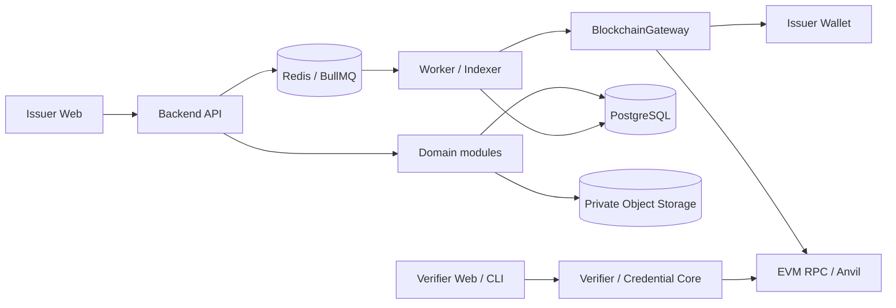
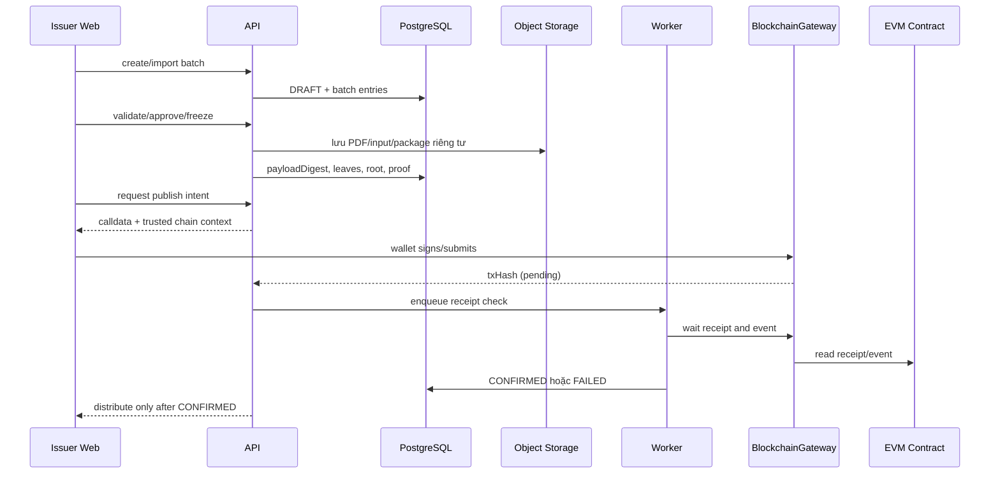

# Kiến trúc đã chốt

## Lựa chọn tổng thể

Hệ thống dùng **modular monolith** cho backend, với worker/indexer chạy như process riêng nhưng dùng chung package domain. Cách này giữ boundary rõ cho đồ án 10 tuần mà chưa tạo chi phí vận hành microservices.



## Ranh giới module

| Module | Trách nhiệm | Không được làm |
| --- | --- | --- |
| Identity & Access | Tài khoản, role, session, policy | Không giữ private key issuer |
| Issuer | Tổ chức, trạng thái, ví được ủy quyền | Không tự sửa trạng thái on-chain |
| Course & Learner | Khóa học, hồ sơ học viên, import | Không tạo Merkle root |
| Batch | Dòng nhập, validate, approve, freeze | Không gọi RPC trực tiếp |
| Credential | Payload, PDF/package metadata, lifecycle | Không tự xác nhận transaction |
| Issuance | Intent, idempotency, publish orchestration | Không tin txHash đơn lẻ |
| Revocation & Reissue | Thu hồi theo leaf, liên kết cấp lại | Không thu hồi tổ chức khác |
| Verification | Kiểm tra offline/on-chain và báo cáo | Không biến lỗi RPC thành `VALID` |
| Audit | Lịch sử thao tác và correlation ID | Không ghi secret/PII dư thừa |
| Worker/Indexer | Receipt, event, retry, backfill | Không chứa rule nghiệp vụ riêng lẻ |

Domain module chỉ phụ thuộc port/interface. HTTP controller, Prisma repository, object storage, Redis và RPC là adapter ở ngoài boundary.

## Luồng dữ liệu phát hành



## Luồng xác minh độc lập

Verifier CLI/web dùng package `credential-core` và RPC trực tiếp. API chỉ là tùy chọn để tải gói/PDF; API dừng không làm mất khả năng kiểm tra nếu verifier đã có package và RPC.

`schema → trusted config → canonical payload → digest/leaf → Merkle proof → on-chain root/status → expiry → optional PDF hash → report`.

Mỗi bước trả `PASS`, `FAIL` hoặc `UNAVAILABLE`. Nếu một bước bắt buộc `UNAVAILABLE`, kết quả chung là `INDETERMINATE`.

## Port chính

Các port cần được định nghĩa trước khi viết adapter:

- `CredentialRepository`, `BatchRepository`, `IssuerRepository`.
- `ObjectStore` cho PDF, file nhập và package; chỉ trả signed URL có hạn khi cần.
- `UnitOfWork` để cập nhật trạng thái và audit atomically.
- `IdempotencyStore` cho publish/revoke/import.
- `BlockchainGateway` cho publish, revoke, receipt và read state.
- `TrustedChainConfig` cho chain ID, registry address và RPC URL đã cấu hình.
- `Clock` và `IdGenerator` để test xác định.

## BlockchainGateway

```ts
export interface BlockchainGateway {
  createPublishIntent(input: PublishBatchInput): Promise<PublishIntent>;
  createRevokeIntent(input: RevokeCredentialInput): Promise<RevokeIntent>;
  inspectTransaction(input: TransactionRef): Promise<TransactionInspection>;
  readBatchAnchor(input: BatchAnchorRef): Promise<OnChainBatch | null>;
  readRevocation(input: CredentialAnchorRef): Promise<RevocationState>;
}
```

`PublishBatchInput` chỉ có dữ liệu đã freeze: `chainId`, `registryAddress`, `issuerId`, `batchId`, `merkleRoot`, `issuedAt`. Gateway không nhận PDF, tên, điểm hoặc private key.

### Mock adapter

Mock adapter dùng deterministic transaction/event fixture, lưu trạng thái trong memory hoặc test repository và hỗ trợ kịch bản `success`, `revert`, `timeout`, `wrong-root`, `duplicate-event`. API/worker chỉ biết interface nên có thể thay bằng EVM adapter mà không đổi use case.

## Cấu hình tin cậy

Mỗi môi trường khai báo allowlist:

```yaml
trustedChains:
  - chainId: 31337
    registryAddress: "0x..."
    rpcUrl: "http://anvil:8545"
  - chainId: 84532
    registryAddress: "0x..."
    rpcUrl: "https://..."
```

Địa chỉ phải được canonicalize về checksum/lowercase theo một quy tắc duy nhất trước khi so sánh. Giá trị thật và secret không commit vào repository.

## Triển khai tối thiểu

- `apps/web`: giao diện issuer/admin.
- `apps/api`: HTTP API và application services.
- `apps/verifier`: verifier web/CLI hoặc package dùng chung.
- `apps/worker`: receipt/event/indexer.
- `packages/credential-core`: schema, JCS, hash, leaf, proof.
- `packages/shared`: enum, error, API DTO và config schema.
- `packages/blockchain`: gateway, EVM adapter và mock.
- `contracts/`: registry contract.

Các thư mục này là target triển khai tiếp theo; tài liệu hiện tại là source of truth cho boundary.

## Điều kiện thay adapter

Luồng application phải có thể chạy với database rỗng và mock gateway theo thứ tự `create batch → validate → approve → freeze → publish intent → confirm`. Khi thay mock bằng EVM gateway, chỉ wiring/configuration thay đổi; controller, state machine, idempotency và response contract giữ nguyên.
