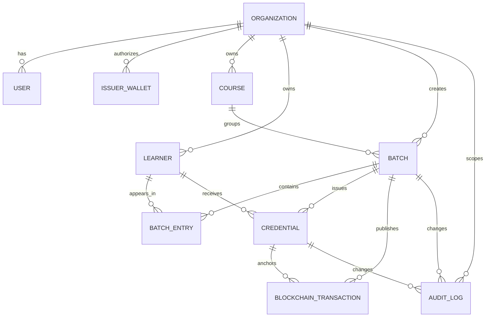
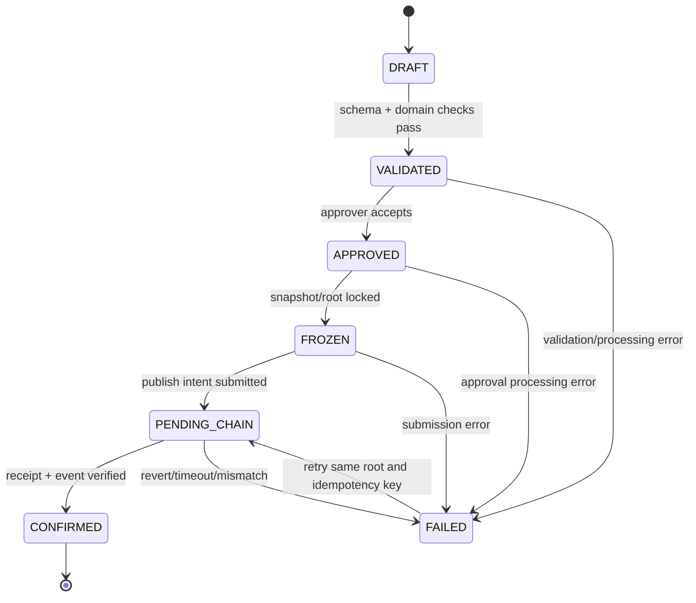

# Mô hình dữ liệu đã chốt

## Nguyên tắc

1. PostgreSQL là nguồn dữ liệu nghiệp vụ off-chain.
2. Object storage riêng tư giữ PDF, file nhập và gói xuất; database chỉ giữ object key, digest và metadata.
3. Blockchain giữ anchor tối thiểu để verifier kiểm tra độc lập.
4. Mọi định danh nghiệp vụ là opaque ID; không dùng email hoặc tên làm khóa.
5. Bản ghi đã freeze/confirm là bất biến về nội dung đã băm.

## ERD logic



## Bảng và ràng buộc chính

### `organizations`

`id`, `legal_name`, `display_name`, `status`, `verification_ref`, `created_at`, `updated_at`.

`status`: `PENDING | ACTIVE | SUSPENDED | REVOKED`. Chỉ `ACTIVE` được phát hành. `verification_ref` không chứa hồ sơ nhạy cảm thô.

### `users`

`id`, `organization_id?`, `email_or_subject`, `role`, `status`, `created_at`, `last_seen_at`.

Role MVP: `SYSTEM_ADMIN`, `ISSUER_OPERATOR`, `ISSUER_APPROVER`, `AUDITOR`. Policy luôn kiểm tra cả role và organization scope.

### `issuer_wallets`

`id`, `organization_id`, `chain_id`, `address`, `status`, `authorized_at`, `revoked_at?`.

Unique `(chain_id, normalized_address)` và unique một bản ghi `AUTHORIZED` trên mỗi `organization_id` trong MVP. Khi thay ví, bản ghi cũ chuyển `REVOKED` trước khi tạo bản ghi mới; một ví không được đồng thời thuộc hai tổ chức trên cùng chain.

### `courses`

`id`, `organization_id`, `code`, `name`, `version`, `description?`, `status`, `created_at`, `updated_at`.

Unique `(organization_id, code, version)`. Course snapshot cần thiết được copy vào credential payload khi freeze để sửa course sau này không đổi chứng chỉ cũ.

### `learners`

`id`, `organization_id`, `subject_ref`, `display_name`, `contact_ref?`, `created_at`, `updated_at`.

`subject_ref` là mã nội bộ hoặc mã đã token hóa. Dữ liệu nhạy cảm chỉ đọc ở module có quyền; không đưa learner record lên chain.

### `batches`

`id`, `organization_id`, `course_id`, `status`, `source_object_key?`, `entry_count`, `merkle_root?`, `input_digest?`, `frozen_at?`, `confirmed_at?`, `failure_code?`, `created_by`, timestamps.

Unique `(organization_id, idempotency_key)` ở bảng command/operation. `merkle_root`, `entry_count` và payload snapshot không đổi sau `FROZEN`.

### `batch_entries`

`id`, `batch_id`, `learner_id`, `result`, `issued_at`, `expires_at?`, `nonce`, `validation_status`, `validation_errors`, `pdf_object_key?`, `pdf_sha256?`, `payload_json`, `payload_digest?`, `leaf?`, `proof_json?`.

Unique `(batch_id, learner_id)` hoặc khóa nghiệp vụ được quy định trong import. `payload_json` là snapshot canonical ngoài chain; proof không nằm trong payload dùng tạo digest.

### `credentials`

`id`, `batch_id`, `batch_entry_id`, `learner_id`, `credential_code`, `status`, `payload_digest`, `leaf`, `pdf_sha256?`, `package_object_key?`, `issued_at?`, `expires_at?`, `revoked_at?`, `revocation_reason?`, `reissued_from_id?`, timestamps.

Unique `credential_code`, unique `(batch_id, leaf)`. Status: `PREPARED | ISSUED | REVOKED | SUPERSEDED`.

### `blockchain_transactions`

`id`, `operation`, `chain_id`, `registry_address`, `organization_id`, `batch_id?`, `credential_id?`, `idempotency_key`, `tx_hash?`, `status`, `block_number?`, `receipt_json?`, `failure_code?`, timestamps.

Status: `CREATED | AWAITING_SIGNATURE | SUBMITTED | CONFIRMED | FAILED | UNKNOWN`. Unique `(chain_id, registry_address, idempotency_key)` và nếu có tx hash thì unique `(chain_id, tx_hash)`.

### `chain_events`

`id`, `chain_id`, `contract_address`, `block_number`, `tx_hash`, `log_index`, `event_name`, `payload_json`, `processed_at?`.

Unique `(chain_id, contract_address, tx_hash, log_index)` để chống event trùng. Cursor đọc bù theo `(chain_id, contract_address, block_number)`.

### `audit_logs`

`id`, `actor_user_id?`, `organization_id?`, `action`, `aggregate_type`, `aggregate_id`, `correlation_id`, `metadata_redacted`, `created_at`.

Không ghi token, private key, PDF, raw PII hoặc payload đầy đủ nếu không cần cho truy vết.

## State machine

### Batch



`FAILED → PENDING_CHAIN` chỉ được retry khi chưa có event xác nhận; không sửa payload/root để retry. Chỉ `CONFIRMED` mới phát hành/đưa credential cho học viên.

### Credential

`PREPARED → ISSUED → REVOKED` hoặc `ISSUED → SUPERSEDED` khi cấp lại. `REVOKED` và `SUPERSEDED` là trạng thái không được verifier báo `VALID`.

## Gói credential và hash

```json
{
  "payload": {
    "credentialId": "...",
    "issuerId": "...",
    "holder": "...",
    "courseId": "...",
    "courseName": "...",
    "result": "...",
    "issuedAt": "2026-01-01T00:00:00Z",
    "expiresAt": null,
    "nonce": "...",
    "pdfSha256": "..."
  },
  "anchor": {
    "chainId": 31337,
    "registryAddress": "0x...",
    "batchId": "...",
    "issuerId": "..."
  },
  "proof": {
    "leaf": "0x...",
    "path": ["0x..."],
    "root": "0x..."
  }
}
```

Quy tắc canonicalization MVP:

- Text được trim theo field schema và chuẩn hóa Unicode NFC trước JCS.
- Timestamp là RFC 3339 UTC với giây và `Z`.
- Số điểm/kết quả định lượng dùng chuỗi decimal canonical để tránh khác biệt kiểu số.
- Field không có giá trị dùng `null` theo schema; không tùy ý bỏ field.
- `payloadDigest = keccak256(UTF8(JCS(payload)))`.
- Leaf ràng buộc `chainId, registryAddress, issuerId, batchId, payloadDigest` theo thứ tự cố định.
- Proof, root và transaction hash không nằm trong payload dùng tạo digest.

## On-chain và off-chain

| On-chain | Off-chain |
| --- | --- |
| issuer ID và ví được ủy quyền | tài khoản, role, thông tin xác minh tổ chức |
| batch ID, Merkle root, issuedAt | khóa học, học viên, kết quả chi tiết |
| trạng thái batch và leaf bị thu hồi | PDF, file nhập, gói JSON, proof cache |
| event publish/revoke | approval, audit, retry, receipt đầy đủ |

## Idempotency và nhất quán

- Client gửi `Idempotency-Key` cho create/import/publish/revoke/reissue.
- Server lưu request hash, actor scope và kết quả; cùng key khác body bị lỗi `409 IDEMPOTENCY_CONFLICT`.
- Publish/revoke dùng outbox hoặc transaction boundary để không mất job sau khi ghi trạng thái.
- Worker upsert theo khóa event; đọc lại event không tạo credential/transaction mới.

## Thứ tự migration ban đầu

Migration PostgreSQL triển khai theo thứ tự: `organizations/users/issuer_wallets` → `courses/learners` → `batches/batch_entries` → `credentials` → `blockchain_transactions/chain_events` → `audit_logs`. Các bảng nghiệp vụ dùng UUID/ULID do hệ thống tạo; enum trạng thái được quản lý trong shared types để schema và application không lệch nhau. Seed chỉ dùng dữ liệu giả lập, không dùng PII hoặc private key thật.
